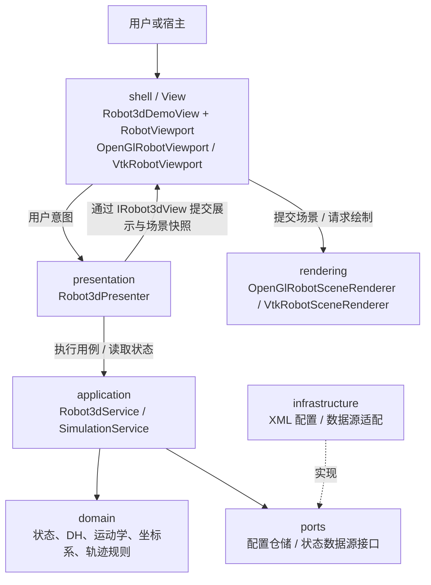
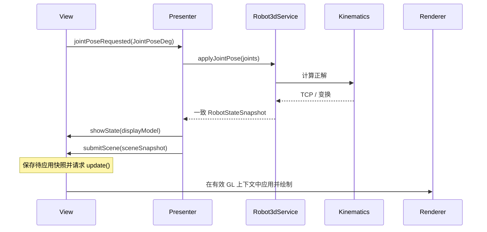

# robot3d_demo MVP 分层架构设计与重构指南

> 文档状态：MVP 主干与双后端渲染已落地；2026-10-22 已统一类名与目录。本文同时保留重构前分析及迁移依据，当前实现见第 17 节，完整旧名映射见 [MVP 命名与目录约定](MVP命名与目录约定.md)。
>
> 编写日期：2026-10-15。当前项目 HEAD：`26e5fe9`；参考项目 HEAD：`5e00993`。分析对象为当时实际读取的工作区源码。
>
> 适用范围：现有机器人三维显示 Demo 的渐进重构，以及后续关节、机型、坐标系、轨迹、工具和数据源等功能开发。
>
> 当前工具链：Qt 5.9.9、MSVC2015 v140 x64、C++11、CMake 3.20+、Assimp 3.2。本文不要求升级工具链。

## 1. 文档定位与阅读方式

本项目采用 **MVP + 应用服务 + 领域模型 + 接口与基础设施 + 独立渲染模块** 作为目标架构。MVP 负责界面与交互的分离；应用服务和领域模型承接机器人状态及计算；渲染模块承接 OpenGL 与几何绘制。

本文提供职责、依赖、数据契约、迁移路径和验收依据。文中新增类名、目录、构建目标及接口均为设计建议，除明确标注的现有类外，不代表仓库已经实现这些类型。

建议阅读顺序：

1. 理解现状与参考实现：第 2～3 节。
2. 确定代码归属与依赖：第 4～6 节。
3. 实施功能链路：第 7～9 节。
4. 开始重构：第 10～12 节。
5. 开发与评审新功能：第 13～15 节。

现有文档继续用于解释原代码：

- [3dmodel 功能层级说明](3dmodel-功能层级说明.md)：现有 L1～L8 功能地图。
- [BaseGeometry 代码详解](L1-渲染底座-BaseGeometry-代码详解.md)：现有几何缓冲与着色器实现。
- [开发配置说明](../.vscode/README.md)：当前构建、运行与调试入口。

这些现状文档与本文描述的目标分层可以并存。功能层级的 L1～L8 与 MVP 的层次并非一一对应；迁移后的实际接口与文档发生变化时，应同步更新本文。

## 2. 重构前结构与重构动因

本节及第 10 节记录 `26e5fe9` 基线的迁移出发点，文件链接指向同名当前文件；旧实现可从该提交查看。

### 2.1 重构前已核对的主要职责

以下旧类名、旧文件名及行为用于说明重构动因；源码链接指向当前对应实现，不代表旧行为仍然存在。

| 当前代码 | 实际承担的工作 | 需要调整的边界 |
| --- | --- | --- |
| [demoui.cpp](../src/robot3d/shell/Robot3dDemoView.cpp) | 构建面板、初始化配置、读取滑条、运行模拟、刷新标签、直接更新三维控件 | 将交互编排和状态修改移出界面 |
| [robot3dglwidget.cpp](../src/robot3d/shell/opengl/OpenGlRobotViewport.cpp) | OpenGL 生命周期、绘制、叠加面板、视角交互、坐标系选择、写入运动相关参数 | 分开界面、领域处理与渲染 |
| [robot3dcontrolwidget.cpp](../src/robot3d/compatibility/LegacyRobot3dViewAdapter.cpp) | 单例入口、更新转发、轨迹采样、长按事件及停止参数写入 | 将兼容入口、轨迹规则和输入事件拆开 |
| [demo_support.h](../include/robot3d/compatibility/LegacyRobotTypes.h) / [demo_support.cpp](../include/robot3d/compatibility/LegacyRobotTypes.h) | 基础类型、运动学、配置、全局数据、UI 桩和旧接口宏映射 | 按职责拆分，减少对整个适配头的依赖 |
| [robotgeometry.cpp](../src/robot3d/rendering/opengl/geometry/OpenGlRobotGeometry.cpp) | 构造时读取全局配置、Assimp 解析、关节顶点变换、VBO 更新和绘制 | 显式传入配置，分开 CPU 数据与 GPU 资源 |
| [basegeometry.h](../include/robot3d/rendering/opengl/geometry/OpenGlGeometryBase.h) 及其他 Geometry | 图元描述、顶点和缓冲、shader、绘制 | 归入渲染侧，避免进入业务 Model |

### 2.2 需要消除的具体耦合

- `DemoUi::ApplyJointFromSliders()` 同时执行读取控件、更新 `DemoDataHub`、更新机器人与 TCP、刷新标签。
- `DemoUi::OnCoordSysChanged()` 通过 `findChild("selCoordSysCb")` 设置三维控件内部下拉框，然后调用其槽函数。
- `DemoUi::OnDisplayFlagChanged()` 直接写入三维控件的多个公开显示标志。
- `Robot3dGLWidget::UpdateCoordSysChange_slot()` 直接组装 `setCoordinateTcpMessage` 并修改全局标志。
- `RobotGeometry` 在构造函数中读取机型和 DH 参数，使初始化顺序与全局对象绑定。
- `Robot3dControlWidget::AddRobotWaypointPath()` 同时判断脚本状态、执行采样规则和操作几何对象的数据列表。

重构完成的判断依据是这些依赖得到隔离，而不是目录名称已经变成 `model/view/presenter`。

## 3. 参考项目与采用范围

参考项目本机位置：

```text
C:\Users\yuguilin\Desktop\gitlab\CGXi_MasterWeld_new\CGXi_MasterWeld_new
```

下列链接按本机两个仓库的相对位置生成，跨电脑时可能需要调整。当前工程的构建与运行不得依赖这个参考目录。

| 参考文件 | 可以借鉴的内容 | 当前项目建议对应 |
| --- | --- | --- |
| [IRobotControlView.h](../../../CGXi_MasterWeld_new/CGXi_MasterWeld_new/include/cgxi/presentation/IRobotControlView.h) | Presenter 通过展示接口反馈结果 | `IRobot3dView` |
| [RobotControlPresenter.cpp](../../../CGXi_MasterWeld_new/CGXi_MasterWeld_new/src/presentation/RobotControlPresenter.cpp) | 操作转发、结果处理、构造注入 | `Robot3dPresenter` |
| [RobotRuntimeFacade.h](../../../CGXi_MasterWeld_new/CGXi_MasterWeld_new/include/cgxi/presentation/RobotRuntimeFacade.h) | 对展示层提供稳定的应用入口 | 按需引入 `Robot3dFacade` |
| [RobotRuntimeService.h](../../../CGXi_MasterWeld_new/CGXi_MasterWeld_new/include/cgxi/application/RobotRuntimeService.h) | 应用服务隔离设备接口 | `Robot3dService` |
| [DeviceStatusDisplayModel.h](../../../CGXi_MasterWeld_new/CGXi_MasterWeld_new/include/cgxi/presentation/DeviceStatusDisplayModel.h) | 展示数据独立于业务状态和设备类型 | `Robot3dDisplayModel` |
| [DeviceStatusPresenter.cpp](../../../CGXi_MasterWeld_new/CGXi_MasterWeld_new/src/presentation/DeviceStatusPresenter.cpp) | 初始状态加载、生命周期检查、版本过滤 | Presenter 状态同步 |
| [DeviceStatusComposition.cpp](../../../CGXi_MasterWeld_new/CGXi_MasterWeld_new/src/presentation/DeviceStatusComposition.cpp) | 创建对象、连接信号、完成接线后启动 | `Robot3dComposition` |
| [设备状态 MVP 说明](../../../CGXi_MasterWeld_new/CGXi_MasterWeld_new/docs/device-status-mvp.md) | 后台事件进入 UI 线程、所有权与测试边界 | 后续实时数据接入设计 |

采用以下原则：

1. 复用参考项目的职责边界、构造注入、View 接口、展示快照和集中装配方式。
2. Presenter 可使用 Qt 的 `QObject`、信号槽和 `QTimer`；领域计算保持独立于 QWidget 和 OpenGL。
3. 简单模块可直接依赖应用服务。参考项目的设备状态 Presenter 就采用此方式；多个应用服务需要统一入口时，再引入 Facade。
4. 当前项目的 OpenGL 渲染需要单独建模，参考项目的普通 Widget 分层只提供界面部分的参照。
5. 事件总线、后台线程和任务框架按实际功能需要引入；初期使用显式调用与信号槽即可。
6. 参考工程的 CMake 设置为 C++17；借用代码时按本项目 C++11 与 MSVC2015 的实际能力适配。

## 4. 目标架构

### 4.1 运行时交互图

实线表示调用或数据流；虚线表示接口实现。该图不表达头文件依赖。



`Robot3dComposition` 在启动时创建对象、注入依赖并连接信号。它不进入每帧的数据计算链。

### 4.2 编译依赖规则

下表中的“依赖”指可以包含其公共头文件或调用其接口。`core` 仅提供结果类型等小型公共类型；`scene` 仅提供无 GPU 对象的场景数据契约。

| 模块 | 允许依赖 | 不应依赖 |
| --- | --- | --- |
| `core` | C++ 标准库 | 上层业务、Qt Widgets、OpenGL |
| `domain` | `core`、C++ 标准库 | presentation、shell、rendering、具体文件/SDK 实现 |
| `ports` | `core`、`domain` | infrastructure、Widget、GPU 资源 |
| `application` | `core`、`domain`、`ports` | shell、Presenter、rendering、具体仓储/数据源实现 |
| `scene` | `core`、`domain` | Widget、shader、OpenGL 上下文与缓冲 |
| `presentation` | application、domain、scene、Qt Core；确有必要时使用 ports | 具体 Widget、具体 Renderer、Assimp、设备 SDK |
| `rendering` | scene、domain、Qt Gui/OpenGL、Assimp | Presenter、应用服务、全局业务单例 |
| `infrastructure` | ports、domain、core，以及具体存储/通信依赖 | Presenter、具体 View |
| `shell` | presentation、scene、rendering、Qt Widgets | 具体配置仓储、设备 SDK、直接修改领域状态 |
| `composition` / `app` | 装配所需的各模块 | 不承接领域规则和每帧绘制 |

底层模块不反向包含 `Robot3dDemoView`、Presenter 或 `OpenGlRobotViewport`。具体基础设施通过实现 `ports` 接口接入，由装配层选择并传入应用服务。

### 4.3 MVP 中的 Model 边界

Model 主要由 `domain + application` 构成；它通过 `ports` 使用外部能力。Model 可以保存机器人状态、执行运动学、解析坐标系语义并处理轨迹采样规则。

`OpenGlRobotGeometry`、`OpenGlGeometryBase`、VBO、shader、相机和 GPU 网格属于显示实现。不能因为类名包含 Geometry 或“模型”，就把它们归到 MVP 的 Model。

## 5. 各层职责与状态所有权

### 5.1 domain：领域状态与纯计算

建议逐步抽取：

| 类型/组件 | 职责 |
| --- | --- |
| `JointPoseDeg` | 六轴关节角，单位显式为度 |
| `RobotConfiguration` | 机型标识、DH 参数、实际配置提供的轴信息与限位 |
| `RobotState` | 当前关节角、TCP、机器人基座位姿和已确认坐标系等 |
| `Kinematics` | 正运动学和位姿运算 |
| `CoordinateSystem` / 坐标变换函数 | 坐标系定义、ID 与类型解析、参考关系计算 |
| `Waypoint` / `TrajectorySampler` | 路点与轨迹数据、采样阈值、容量策略 |

领域对象不存 `QWidget*`、`QOpenGLBuffer`、`QColor` 或 Assimp 场景指针。颜色等显示信息进入展示或场景契约。

现有 Demo 的滑条限位是演示常量，不能在迁移时直接当作真实机器人配置事实。配置尚未提供的数据应显式区分演示默认值。

### 5.2 application：用例与统一状态入口

- `Robot3dService`：协调机型配置、关节调整、位姿更新及状态读取。
- `CoordinateSystemService`：当坐标系处理已足够复杂时独立；初期也可作为 `Robot3dService` 内部职责。
- `SimulationService`：保存模拟时间与启停状态，按明确的 `dtSeconds` 推进。
- 路点管理服务：接收状态样本，调用领域采样规则并保存路点/轨迹。

机器人领域状态通过应用服务更新。View、Renderer 和兼容门面不得各自保存可独立修改的第二份权威状态。

应用服务返回值数据和明确的成功/失败结果。数据变更后对外提供一致快照，避免界面读到“新关节角 + 旧 TCP”。

### 5.3 presentation：Presenter、展示模型与接口

`Robot3dPresenter` 接收切换机型、调整关节、模拟启停、选择坐标系、改变显示项等意图，调用应用服务，再构造展示数据。

`IRobot3dView` 表达展示能力，例如显示数值与选项、提交场景快照、反馈错误；不暴露滑条、内部下拉框、Geometry 或 GPU 对象。

`Robot3dDisplayModel` 保存展示所需的数值、选项和可用状态。文案本地化与具体控件格式化优先留给 View；业务状态应以明确字段表达。

显示选项由 Presenter 管理一个统一的 `RobotDisplayOptions`；工具栏、侧栏和视口叠加按钮都发送同一种意图，再根据同一个结果刷新，避免多处布尔值互相覆盖。现有 `showEndToolStatus` 与 `toolShowSignal` 控制不同对象，迁移时应保留各自的选项语义，不能因为都与工具有关就合并。

### 5.4 shell：具体 View 与用户输入

`Robot3dDemoView` 组织窗口和控制面板并实现 `IRobot3dView`，通过 `RobotViewport` 提交场景。`OpenGlRobotViewport` 与 `VtkRobotViewport` 是同层的后端视口，负责相机、输入、叠加面板和渲染调度；点云窗口 `PointCloudViewerDialog` 与 `VtkPointCloudViewport` 也归 shell。

View 可以：

- 读取控件并发出关节角、坐标系 ID 等语义明确的意图。
- 设置标签、滑条、复选框和错误提示；回填时阻止递归触发输入事件。
- 管理布局、弹窗、图标、鼠标拖动与触摸输入。
- 在渲染器就绪前缓存最新场景，调用 `update()` 请求绘制。

View 不直接调用 `LoadRobotType()`、正解函数、配置仓储或机器人 SDK，不通过内部 `objectName` 跨组件访问业务状态。

### 5.5 rendering：场景与后端绘制

`OpenGlRobotSceneRenderer` 与 `VtkRobotSceneRenderer` 接收同一场景快照，管理机器人、TCP、坐标轴、路点、安全平面及工具的绘制。OpenGL 图元统一为 `OpenGl*Geometry`，归 `rendering/opengl/geometry`；显示比例由 `SceneUnits.h` 共享。

`RobotMeshLoader` 初期放在渲染模块，负责 CPU 网格解析；GPU 上传由 Renderer 单独完成。如果后续确实需要共享或替换加载器，再抽取专用接口。

Renderer 不读取 `DemoDataHub`、`RobotConfig` 或 `SoftwareUI_Controller`，也不写运动控制标志。绘制所需配置、安装角和关节角均从显式输入获得。

### 5.6 状态归属速查

| 状态 | 权威持有者 | 其他组件的使用方式 |
| --- | --- | --- |
| 机型、DH、关节角、TCP、坐标系定义 | 应用服务持有的领域对象 | 获取只读快照 |
| 模拟时间、模拟启停 | `SimulationService` | Presenter 发起用例、读取状态 |
| 路点及轨迹样本 | 路点/轨迹服务 | 场景快照提供绘制数据 |
| 显示坐标轴、路点、轨迹、工具等选项 | Presenter 的显示状态 | 所有控件与 Renderer 根据同一快照显示 |
| 旋转、平移、缩放、旋转中心、视角备份 | View 侧的 `CameraState` | Renderer 接收视角参数 |
| 控件选中项、编辑中的文本 | View | 确认输入后发送意图 |
| 顶点缓冲、shader、GL 能力信息 | Renderer / 视口上下文 | 不向业务层暴露 |
| 文件根目录与资源定位 | 仓储/资源解析器，由 composition 配置 | 向服务或 Renderer 提供明确描述 |

相机属于表现状态。机器人坐标系定义属于领域状态；将该坐标系应用到观察矩阵属于渲染适配，两者需要分开。

## 6. 目录与接口形态

### 6.1 当前目录

以下表示当前自有代码的模块归属；按职责新增文件，避免把具体 View 放入 presentation 或 rendering。

```text
robot3d_demo/
├── main.cpp
├── include/robot3d/
│   ├── core/                 Result
│   ├── domain/               RobotTypes / Kinematics / TrajectorySampler / PointCloud
│   ├── ports/                IRobotConfigRepository
│   ├── application/          Robot3dService / SimulationService
│   ├── scene/                RobotSceneSnapshot / RobotDisplayOptions
│   ├── presentation/         IRobot3dView / Robot3dPresenter / Robot3dDisplayModel
│   ├── infrastructure/       XmlRobotConfigRepository / PointCloudFileLoader
│   ├── rendering/            RobotMeshLoader / CameraState / SceneUnits
│   │   ├── opengl/           OpenGlRobotSceneRenderer / geometry/OpenGl*Geometry
│   │   └── vtk/              VtkRobotSceneRenderer / VtkSceneMath
│   ├── shell/                Robot3dDemoView / RobotViewport / PointCloudViewerDialog
│   │   ├── opengl/           OpenGlRobotViewport
│   │   ├── vtk/              VtkRobotViewport / VtkPointCloudViewport
│   │   └── input/            LongPressRepeatFilter
│   ├── compatibility/        LegacyRobot3dViewAdapter / LegacyRobotTypes
│   └── composition/          Robot3dComposition
├── src/robot3d/               与公共头文件按模块对应的实现
├── tests/                    按被验证的组件命名
├── shaders/
├── resource/
├── robotType/
├── assimp/
└── docs/
```

建议统一使用 `robot3d` 命名空间，并按模块增加子命名空间。类名在首次实现时确定，后续更新本指南。资源和模型目录先保持现有部署方式。

### 6.2 最小接口示意

以下仅表达职责，不是可直接编译的完整代码；相关类型由各模块提供，方法名可在实际实现中细化。

```cpp
class IRobot3dView
{
public:
    virtual ~IRobot3dView() {}
    virtual void showState(const Robot3dDisplayModel& model) = 0;
    virtual void submitScene(const RobotSceneSnapshot& scene) = 0;
    virtual void showError(const OperationError& error) = 0;
};

class Robot3dService
{
public:
    // 仓储由装配层注入；服务不创建具体 XML 实现。
    explicit Robot3dService(IRobotConfigRepository& repository);
    Result<RobotStateSnapshot> applyJointPose(const JointPoseDeg& joints);
    RobotStateSnapshot snapshot() const;
};

class Robot3dPresenter : public QObject
{
    Q_OBJECT
public:
    Robot3dPresenter(IRobot3dView& view,
                     Robot3dService& service,
                     SimulationService& simulation,
                     QObject* parent = 0);
    void onJointPoseRequested(const JointPoseDeg& joints);
    void onCoordinateSystemRequested(const CoordinateSystemId& id);
    void onDisplayOptionsRequested(const RobotDisplayOptions& options);
};
```

示例中的依赖引用要求其对象生命周期覆盖使用者。Presenter 通过 View 接口输出，不调用具体 Renderer。View 的具体输入信号在 composition 中连接；无需把 Qt 信号加入纯虚展示接口。

若某展示回调需要指向宿主（例如“确认当前位姿”），输出语义事件和数据。不要将旧 `editPushButton`、按钮名称或外部控件指针扩散到新的业务接口。

## 7. 数据契约、单位与一致性

### 7.1 三类快照

| 契约 | 用途 | 内容约束 |
| --- | --- | --- |
| `RobotStateSnapshot` | 应用服务对外提供一致业务状态 | 机型、关节角、TCP、坐标系及必要版本信息；不含控件和 GPU 数据 |
| `Robot3dDisplayModel` | Presenter 向 View 提供展示数据 | 数值、选项、选择项、可用状态和错误状态；不包含服务指针 |
| `RobotSceneSnapshot` | View 向 Renderer 提供场景数据 | 机器人配置/资源描述、关节角、TCP、坐标轴、工具和轨迹等值数据；不含 QWidget、VBO、shader |

场景快照由 Presenter 根据领域快照与显示选项构建，放在共享的 `scene` 契约模块，避免 Renderer 反向依赖 Presenter 实现。

交付后视为只读；初期可按值拷贝。网格等大资源按稳定标识或具有明确所有权的只读描述传递，避免每帧深拷贝。需要异步加载或后台样本时再增加请求 ID、版本与时间戳。

### 7.2 已发现的单位与旋转语义问题

下列是现状核对结果，不应据此假定所有旧调用已经一致：

| 位置 | 当前实际情况 | 实施要求 |
| --- | --- | --- |
| `JointPose`、滑条、正解输入 | 关节角按度处理 | 新类型/字段显式注明 `Deg` |
| DH 参数解析及 `cr_ForwardKineFull()` | `alpha/theta` 按弧度参与计算，`a/d` 为长度；读取了 `beta`，现有正解未使用它 | 保留旧数值路径；支持其他机型前核对 DH 定义与 beta 语义 |
| `Pose` 类型注释 | 声称旋转部分为弧度轴角向量 | 不能单凭该注释确定所有接口 |
| `PoseToMatrix()`、`MatrixToPose()`、正解输出 | 按 ZYX 欧拉角度数计算/输出 | 记录这些函数的实际输入输出语义 |
| `cr_Eule2AxisAngle()` / `cr_AxisAngle2Eule()` | 显式进行欧拉角度数与弧度轴角向量转换 | 为转换边界建立数值样本 |
| `AxisAngle2RotateMatrix()` | 注释声称弧度轴角，但函数先乘 `PI/180` 再按轴角处理 | 调用者和函数语义需要联合核对，不能仅改注释或仅删除换算 |
| `G_SCALE` | 当前值为 `0.04`，存在网格加载、图元与矩阵中的多处换算 | 每种数据沿链路只换算一次；按具体 Geometry 入口检查 |

目标约定：

- 业务长度使用 mm，关节角使用度，DH 角度字段保持显式弧度语义。
- 新接口区分 `EulerZyxDeg` 与 `AxisAngleRad`，或使用表达清楚的刚体变换类型。不得继续用不带语义说明的六个数字承载两种旋转表示。
- 领域计算保持物理单位；渲染边界把 mm 换算为模型单位，Renderer 负责与旧 Geometry 入口适配。
- `cr_PoseTrans(result, pose1, pose2)` 当前实现是 `inverse(pose2) * pose1`；迁移时按矩阵语义验证，不能依据函数名猜测乘法顺序。
- 坐标系链统一说明 `T_A_B` 的含义，例如“将 B 系中的点转换到 A 系”。明确后再固化新接口。

先为现有行为建立样本，再拆分代码；涉及旋转解释或公式修正的变更应单独记录和验收。本文不宣称现有显示与运动学已经完全一致。

### 7.3 输入与状态约束

- 服务入口校验轴数量、有限数值、机型配置和必要的限位；界面校验不能替代服务校验。
- 配置必须校验 XML 解析错误、DH 数量和数值有效性。失败时不发布半更新配置。
- 坐标系按稳定 ID 传递，禁止以两个下拉框的行号作为跨组件协议。
- “请求切换的坐标系”与“数据源已确认的坐标系”需要分别表达；模拟环境可同步确认，真机环境以回读为准。
- 更换机型、切换数据源和恢复默认状态时，明确哪些状态保留、哪些重置，并在测试中固定行为。

## 8. 主要功能数据流

### 8.1 调整关节



失败时显示错误并保留上一次有效状态。由同一快照更新滑条、数值标签、机器人和 TCP。回填滑条期间屏蔽输入反馈，不能再次触发一次业务写入。

### 8.2 模拟运动

1. View 发出启停意图，Presenter 调用 `SimulationService`。
2. Presenter 或专用调度适配器持有 `QTimer`；模拟服务接收 `step(dtSeconds)`，算法内部不读取系统墙钟。
3. 模拟服务持有实例级时间，生成关节样本，经统一应用入口计算状态。
4. Presenter 将同一状态映射为数值与场景。
5. 暂停、恢复、切换机型后的时间处理策略应与基线一致；需要新行为时单独确认。

当前 `StepSimulation()` 的时间是函数内静态变量，迁移时改为实例状态以便重置与重复验证。现有演示 TCP 速度由 UI 生成正弦值；应迁入模拟服务并标明模拟来源，不能当作真实速度测量。

### 8.3 切换机型

目标行为是配置和模型都准备成功后，才呈现新的机型与状态：

1. Presenter 提交机型 ID，应用服务通过配置仓储读取并校验候选配置，暂不替换当前有效状态。
2. View/Renderer 根据候选资源描述准备 CPU 网格与 GPU 资源；GPU 准备必须等待有效上下文。
3. 准备成功后反馈 Presenter，应用服务提交候选机型，并按约定生成初始状态；View 激活新场景。
4. 失败时释放候选资源、保留旧有效状态和场景，并恢复机型选择项、显示错误。
5. 出现连续切换或异步加载时使用请求 ID 丢弃旧结果。

这是目标用例约定，现有实现尚不具备完整的候选准备与提交过程。初期可在 UI 线程实现，保留相同的成功/失败语义；不要求立即引入后台加载。

### 8.4 坐标系切换

- View 发出 `CoordinateSystemId`，Presenter 调用坐标系用例。
- 应用服务计算或请求目标坐标系；结果包含实际确认的坐标系及其变换。
- Presenter 根据结果同时更新侧栏、视口叠加面板与场景坐标轴。
- Renderer 只应用给定变换，不查找全局配置或写 `setTCPInCoordSysSignal`。
- 旧通信字段由兼容适配器在边界映射；不能扩散到 View。

### 8.5 显示项、视角与位姿确认

- 显示开关：所有入口向 Presenter 发出相同的选项变更，合并后统一回填。
- 相机拖动、缩放和复位：由 View 侧视角组件处理，避免每个鼠标增量都绕行应用服务。
- 安装视角：安装姿态来自领域配置，视角备份和恢复属于表现状态。
- 确认/取消位姿：输出明确的位姿结果或取消事件，由宿主处理业务；旧按钮对象名由兼容适配器解释。

### 8.6 后续实时数据源

需要真机、文件回放或网络数据时，新增 `IRobotStateSource` 实现。状态源负责提供带清楚单位、有效性和来源的样本；应用服务决定如何更新业务状态。

若使用后台线程：样本通过队列或排队信号到达 UI 侧，再由 Presenter 更新 View。高频样本可以只保留最新状态，但路点采样若要求完整顺序，应走独立有界队列，不能随显示丢帧而丢失所需数据。

模拟与实时数据之间需要一个明确的活动来源；切换时停止或隔离旧来源，并丢弃旧来源迟到的样本。机器人控制命令与观察数据分别设计接口，三维显示不直接执行设备运动。

## 9. OpenGL、初始化、线程与生命周期

### 9.1 GL 更新原则

`update()` 只是请求重绘，不保证调用它时 OpenGL 上下文已经是当前上下文。现有 `multjointTransform()`、图元更新与 `LoadMesh()` 内含缓冲操作，不能简单移到普通业务回调里继续执行。

推荐流程：

1. `submitScene()` 仅保存待处理场景，并置脏标记。
2. `initializeGL()` 创建 Renderer 的 GPU 资源。
3. `paintGL()` 在绘制前应用待处理数据、更新必要缓冲，再执行绘制。
4. 模型切换、工具更新等也通过待处理请求进入相同的上下文边界。
5. 必须在其他位置进行 GPU 操作时，显式保证相应上下文有效；后台 CPU 解析不创建或操作主视口的 GPU 对象。

Renderer 可分为 CPU 解析、GPU 上传与绘制三个步骤。首次迁移保留现有顶点变换算法，后续有性能依据时再评估改为矩阵驱动等实现。

### 9.2 初始化顺序

- composition 创建配置仓储、应用服务、View 与 Presenter，完成依赖注入和信号连接。
- 配置准备完成后，Presenter 可立即提交初始快照；View 在 GL 尚未就绪时缓存它。
- 视口完成 `initializeGL()` 后消费缓存，或发出明确的就绪事件。
- 初始状态加载不依赖任意毫秒数。逐步替换当前 120 ms 的归零与 900 ms 的导帧触发方式。
- 导帧验证需要等待指定场景已经应用并绘制完成，再抓取帧缓冲。

### 9.3 所有权与销毁

| 对象 | 推荐持有方式 |
| --- | --- |
| 配置仓储、应用服务、模拟服务 | composition 的普通值成员或 `std::unique_ptr` |
| Presenter、调度对象 | composition 独占或明确的 Qt 父子关系，选择一种权威所有权 |
| View 与子控件 | Qt 父子关系 |
| Renderer | 视口独占，GPU 资源在有效上下文期间显式清理 |
| 外部数据源 | composition 管理，关闭时先停止并解除回调 |

建议销毁顺序：停止定时器和数据源、断开/取消回调、销毁 Presenter、由视口清理 Renderer 和 GPU 资源并销毁 View、最后释放服务与仓储。由宿主拥有 View 时，应明确约定并检查其存活状态。

不要同时用 QObject 父对象与独立拥有型智能指针无序管理同一堆对象。若采用兼容门面，门面只持非拥有引用，并在对象失效时清除。

### 9.4 后续跨线程约定

Qt 排队信号使用自定义值类型时，在建立跨线程连接前完成元类型声明/注册。回调不得持有已销毁 View 的裸指针；对象销毁时需要解除订阅，必要时使用存活检查与数据源代次过滤。

首轮重构保持现有 UI 线程运行方式；后台执行能力在实际接入场景出现时另行增加和验证。

## 10. 现有代码迁移映射

| 现有位置/方法 | 目标归属 | 迁移要点 |
| --- | --- | --- |
| `DemoUi::BuildControlPanel()`、标签更新 | shell | 保留布局和显示，输入输出改用明确数据 |
| `ApplyJointFromSliders()`、`OnJointSliderChanged()` | View + Presenter + Service | View 组装意图，Service 更新状态，Presenter 分发展示 |
| `OnSimTimer()`、`StepSimulation()` | Presenter 调度 + SimulationService | 移出 UI 中的模拟与速度计算，消除静态模拟时间 |
| `OnRobotTypeChanged()` | Presenter + Service + 仓储 + Renderer | 候选配置与模型准备成功后统一提交 |
| `OnCoordSysChanged()` | Presenter + 坐标系用例 | 按 ID 传递，移除跨控件 `findChild()` 与行号协议 |
| `OnDisplayFlagChanged()`、`SetShowType()` | Presenter 显示状态 + View + Renderer | 分开面板显隐、场景显示项和坐标系计算 |
| `Robot3dGLWidget::InitUI()` | shell 的视口叠加面板 | 仍可叠加在视口，业务操作发出意图 |
| `initializeGL/resizeGL/paintGL()` | 视口桥接 + Renderer | View 保持 Qt 回调，具体资源和绘制下沉 |
| `ViewChangeMatrixFunction()` | 坐标变换 + 场景适配 | 分开纯变换计算、轴线数据生成和 GPU 更新 |
| `UpdateCoordSysChange_slot()`、`updateUseCoordSysSlot()` | Presenter + 应用服务 + 兼容适配器 | 分开选择请求、设备回读、UI 同步 |
| `EditRobotPoseBtn_slot()`、`editPushButton` | View 意图 + 宿主适配器 | 输出位姿确认/取消，移除业务对外部按钮对象的依赖 |
| `Robot3dControlWidget` 的转发接口 | 过渡兼容门面 | 按旧参数转换为新意图，不存第二份状态 |
| `AddRobotWaypointPath()` | 路点服务 + TrajectorySampler + Renderer | 保留并验证脚本状态门控、阈值与容量语义 |
| `TouchLongPressFilter` | shell 输入适配 + 应用用例 | View 识别按压；停止请求交给应用入口 |
| `DemoDataHub` 的公开字段 | RobotState / 配置 / 服务 | 收口读写，按值快照替代任意字段修改 |
| `RobotConfig` | 配置模型 + 仓储/服务 | 拆开静态定义、动态选择及变更通知 |
| `cr_*` 计算函数 | domain 的运动学与转换 | 明确类型和单位，先保留数值路径 |
| `RobotGeometry` 构造函数 | Renderer 初始化 | 从显式配置/资源描述构造，移除全局读取 |
| `RobotGeometry::LoadMesh()` | RobotMeshLoader + GPU 上传 | Assimp 数据转自有 CPU 数据后，再创建缓冲 |
| `showEndToolStatus`、`g_openglVersion` | 显示状态 / Renderer 能力状态 | 前者归统一选项，后者随上下文管理 |
| `TipMsgDialog`、日志桩、`SoftwareUI_Controller` | View 反馈 / 日志边界 / 显式事件 | 按实际使用拆分，逐步清除总适配头 |

过渡期间允许旧接口继续存在，但要列出迁移对象。新功能不再新增 `CommDataController` 宏依赖、全局 `GetInstance()` 读取或对 Geometry 成员的直接写入。

## 11. 渐进实施计划与阶段验收

### 阶段 0：建立基线并明确语义

- 记录三种机型加载、零位、非零关节、90 步模拟与主要显示项的结果。
- 核对 Pose 旋转语义、坐标系变换方向、G_SCALE 及机型几何链与正解链的对应关系。
- 标记已知现状问题；行为修正单独列项，不把它们混入机械搬文件的变更。

验收：能重复取得业务数值和初始/运动后图像；已知不一致有明确记录，不把现状截图当作数学正确性的证明。

### 阶段 1：抽取数据类型、运动学与配置仓储

- 分离基础类型、纯计算和 XML 读取；旧数据中枢暂通过这些组件完成原有功能。
- 保持原文件编码与行尾，避免夹带格式重写。

验收：当前 Demo 可运行；计算与配置可以脱离 QWidget 和 OpenGL 验证；配置失败不生成半更新状态。

### 阶段 2：打通首条 MVP 链路

- 建立 `IRobot3dView`、`Robot3dPresenter`、`Robot3dService` 和 composition。
- 优先迁移“关节调整 → 正解 → 数值与场景更新”，随后迁移归零与模拟。
- 将现有 GL 控件临时作为 View 内部适配对象，保留未迁移功能。

验收：关节业务入口不再位于 DemoUi；Presenter 不包含具体 Widget/Geometry 头；可用测试 View 验证一致更新和失败反馈。

### 阶段 3：迁移机型、坐标系、显示项与路点

- 统一状态与显示选项，去除内部下拉框访问和公开标志位写入。
- 为机型切换增加明确的准备、成功与失败处理。

验收：侧栏与叠加面板状态一致；失败时旧场景可继续使用；路点容量和采样规则保持已确认行为。

### 阶段 4：独立渲染模块

- 提取场景契约、Renderer、网格加载和相机状态，封闭 GL 资源生命周期。
- 删除 Geometry 对全局配置的读取。

验收：业务层不接触 GPU 资源；首帧、隐藏后显示、缩放、连续切换和关闭窗口可正常完成；多次切换不持续积累旧资源。

### 阶段 5：收敛兼容层并支持扩展

- 移除无调用的旧入口与宏映射，保留必要宿主适配接口。
- 有实际需求时增加回放或实时状态源，再增加对应线程与生命周期验证。

验收：新功能沿目标依赖实现；兼容层没有第二套状态；独立组件可被其他宿主显式装配。

每个阶段独立构建与验证后再推进。无需在第一批同时更换绘制算法、资源格式、工具链或全部对外接口。

## 12. 构建与验证约定

### 12.1 构建边界

当前 [CMakeLists.txt](../CMakeLists.txt) 按职责组织构建目标，具体 View 和兼容适配不编入渲染目标：

| 构建目标 | 内容 | 依赖重点 |
| --- | --- | --- |
| `robot3d_core` | core、domain、ports、application | C++11，不链接 Widgets/OpenGL/Assimp |
| `robot3d_scene` | 场景契约头文件 | domain；可作为 INTERFACE 目标 |
| `robot3d_infrastructure` | XML 仓储与具体数据源 | core、Qt Core/Xml 及实际数据源依赖 |
| `robot3d_presentation` | View 接口、Presenter、展示数据 | core、scene、Qt Core |
| `robot3d_rendering` | CPU 网格加载 | Qt Gui、Assimp；不创建 GPU 对象 |
| `robot3d_rendering_opengl` | OpenGlRobotSceneRenderer、OpenGL Geometry | scene、Qt Gui/OpenGL、CPU 网格加载 |
| `robot3d_rendering_vtk` | VtkRobotSceneRenderer、VTK 场景适配 | scene、Qt Gui、VTK、Assimp |
| `robot3d_shell` | 具体 View、视口和输入、composition | presentation、rendering、Qt Widgets |
| `robot3d_compatibility` | 旧宿主 View 适配 | shell、旧值类型 |
| `robot3ddemo` | main.cpp 与资源 | shell、Qt Widgets |

禁止通过全局包含目录或将 `LegacyRobotTypes.h` 包含到所有新头文件中掩盖依赖。AUTOMOC 对含 `Q_OBJECT` 的新头文件需要正确登记。

沿用现有模型资源部署、MSVC2015 x64 Assimp 依赖、Debug/Release 运行库选择和本机 `QT_DISABLE_SHADER_DISK_CACHE=1` 配置。构建路径与工作目录以现有任务脚本为准。

### 12.2 验证矩阵

| 验证层 | 需要覆盖的行为 |
| --- | --- |
| 领域数值 | 已知 DH 的正解、非零旋转、位姿求逆/组合、单位与坐标方向；用独立期望值或几何不变量验证 |
| 配置 | 三种现有机型，缺失文件、坏 XML、DH 数量错误与非法数值，失败不污染旧配置 |
| 应用服务 | 一次更新得到一致关节/TCP；模拟时间可重复；切换失败保持状态；活动数据源隔离 |
| Presenter | 使用测试 View 验证输入处理、错误反馈、显示项同步、避免回填循环 |
| 渲染集成 | 首帧、非零关节、TCP、坐标轴、工具、路点、轨迹、安装视角、连续机型切换和资源释放 |
| 生命周期 | 未就绪时输入、关闭时仍有定时回调、重复创建与销毁、后台迟到样本 |
| 工程 | Debug/Release 构建与启动，资源定位和原有运行入口 |

只为新增或迁移的实质边界补充测试；不机械复制实现。数值与截图互相补充：截图不能证明运动学正确，数值验证也不能证明 GPU 已正确显示。

### 12.3 现有导帧入口

当前已存在以下环境变量，实现在 `Robot3dDemoView::OnCheckDump()`：

| 变量 | 当前用途 |
| --- | --- |
| `DEMO_DUMP_FRAME` | 导出最终帧并退出 |
| `DEMO_DUMP_START` | 可选，导出推进前的初始帧 |
| `DEMO_DUMP_SIMSTEPS` | 导帧前推进固定数量模拟步，每步 0.04 秒 |

重构期间保留该验证能力，逐步改为通过新服务推进、等待场景绘制完成后导帧。图像对比使用相同机型、视角、窗口尺寸与步数；不同驱动的像素差异需与对象位置、轮廓和业务数值结合判断。

上述内容同时定义后续扩展的目标边界；当前已实现的类型、测试和保留事项见第 17 节及实施记录。

## 13. 新功能开发约定与示例

### 13.1 功能归属判断

| 新需求 | 优先落点 |
| --- | --- |
| 新增按钮、面板布局、提示文案 | shell |
| 用户操作协调多个用例、统一回填多个控件 | presentation |
| 新的机型切换、轨迹管理或数据源选择用例 | application |
| 新的运动学、坐标规则、轨迹采样算法 | domain |
| XML/JSON 文件读写、设备或网络接入 | ports 定义所需能力，infrastructure 实现 |
| 新图元、着色器、材质、绘制排序、相机交互 | rendering / View 侧视角组件 |
| 向宿主提供新的组合入口或实现切换 | composition / 宿主适配器 |

### 13.2 示例：新增“记录当前位姿为路点”

1. domain 定义路点所需的机器人与坐标系语义，明确关节角/空间位姿各自的用途。
2. application 在一次一致状态上记录路点，并处理数量、重复或采样规则。
3. Presenter 处理“记录路点”意图，更新数量、列表和场景快照。
4. View 只提供按钮、列表与反馈；Renderer 根据场景数据绘制路点。
5. 如需持久化，另加仓储接口和文件实现；不在按钮回调中直接读写文件。
6. 验证非零姿态、坐标系切换、失败状态及视图同步，不通过直接修改 Geometry 的 pointList 实现业务。

### 13.3 示例：增加真实机器人状态显示

1. 先定义状态源样本的单位、有效性、来源和采样时间。
2. 在 infrastructure 实现 `IRobotStateSource`，把具体 SDK 数据转换为应用可理解的数据。
3. 应用服务选择唯一活动数据源并处理失效/恢复；数据更新与设备运动命令分开。
4. 按第 9 节进入 UI 线程，Presenter 提交展示与场景。
5. 验证断连、切换来源、旧样本迟到和关闭流程。

现有 Demo 中的通信/内存监控桩并不提供完整设备能力。新数据源应明确实现自己的契约，不以原有标志位存在作为已实现设备动作的依据。

## 14. 重构与新功能评审要点

- 当前变更对应的用例、权威状态和层次归属是否清楚？
- Presenter 是否仅依赖 View 接口和应用入口？业务层是否新增了 Widget、OpenGL 或具体 SDK 依赖？
- 数据是否通过稳定 ID、值类型和一致快照传递？是否重复保存了可修改状态？
- 单位、旋转表示、坐标系和变换方向是否显式？G_SCALE 是否在边界只应用一次？
- GPU 操作是否发生在有效上下文中？首帧、切换和销毁是否覆盖？
- 错误是否保持旧有效状态或按照已确认策略处理？是否存在半更新机型/场景？
- 兼容代码是否只做映射？是否新增全局单例、宏映射、跨组件 findChild 或公开字段写入？
- 是否验证了本次实际改变的边界，并同步更新文档与迁移记录？

## 15. 实施前需完成的语义核对与决策

下列条目可以在对应阶段准备期间完成，不要求本次编写文档时修改程序：

| 条目 | 当前依据 | 实施时需要明确的结果 |
| --- | --- | --- |
| Pose 的旋转表示 | 注释与多个转换入口不一致 | 逐入口的真实语义、新类型及兼容转换样本 |
| 坐标系乘法与 ID 映射 | 已有工具、用户、工件、基座等分支 | 统一变换命名、ID 解析和数值基线 |
| 正解与视觉关节链一致性 | 正解采用 DH；网格链存在机型相关轴与中心计算 | 三种机型的对应关系及支持范围 |
| 关节限位 | 当前是 UI 中的演示常量 | 配置来源、超限处理及模拟/实时差异 |
| 模拟中的手动输入 | 当前定时模拟与滑条更新共享状态 | 保持现状的范围；需要调整时确认交互策略 |
| 切换机型时的关节和视角 | 目前依赖多个旧函数串联 | 哪些保留、哪些重置及失败恢复行为 |
| 路点与轨迹 | 有脚本状态、坐标差阈值及容量逻辑 | 采样规则的准确语义，业务记录与显示降帧是否分离 |
| 宿主集成范围 | 存在旧单例接口与外部按钮回调 | 需要保留的调用契约、替代事件及移除条件 |

架构确定为上述分层；这些事项属于行为与数学语义的核对。若处理结果改变现有用户行为或数据含义，应单独说明并确认后实施。

## 16. 架构决策记录与完成标准

| 决策 | 理由 |
| --- | --- |
| 采用 MVP 配合应用/领域分层 | 将控件输入、用例编排与机器人计算分别维护 |
| 独立 rendering 与 scene 契约 | OpenGL 生命周期和表现数据需要清楚边界 |
| 通过构造注入与 composition 装配 | 降低全局状态和初始化顺序依赖 |
| 单一业务状态入口与只读快照 | 保证数值、选项与三维场景同步 |
| Facade、事件总线、后台线程按需增加 | 当前规模可以先用直接服务调用和信号槽完成 |
| 先保留工具链、资源与已确认行为 | 降低每批迁移涉及的变量，便于定位回归 |

完成首轮重构至少应满足：主要交互通过 Presenter 和应用服务；View 不直接修改业务全局状态；Renderer 不访问业务单例；单位与旋转契约明确；GL 初始化/更新/释放边界可验证；原有主要功能与必要的兼容入口仍可使用。

后续每一批实现应在变更说明中记录“迁移的链路、清除的旧依赖、实际验证、剩余兼容点”。本文维护架构边界，原代码讲解文档保留历史实现，当前类名和目录以命名约定及第 17 节为准。


## 17. 当前落地实现（2026-10-22 命名整理后）

本轮已完成主要交互、状态计算、配置读取、场景交付和 GPU 管理的分层。详细变更与验证方式见 [MVP 重构实施记录](MVP重构实施记录.md)。

| 模块 | 实际入口 |
| --- | --- |
| domain / application | [RobotTypes](../include/robot3d/domain/RobotTypes.h)、[Kinematics](../src/robot3d/domain/Kinematics.cpp)、[Robot3dService](../src/robot3d/application/Robot3dService.cpp)、[SimulationService](../src/robot3d/application/SimulationService.cpp) |
| ports / infrastructure | [IRobotConfigRepository](../include/robot3d/ports/IRobotConfigRepository.h)、[XmlRobotConfigRepository](../src/robot3d/infrastructure/XmlRobotConfigRepository.cpp) |
| presentation / scene | [IRobot3dView](../include/robot3d/presentation/IRobot3dView.h)、[Robot3dPresenter](../src/robot3d/presentation/Robot3dPresenter.cpp)、[RobotSceneSnapshot](../include/robot3d/scene/RobotSceneSnapshot.h) |
| rendering | [OpenGlRobotSceneRenderer](../src/robot3d/rendering/opengl/OpenGlRobotSceneRenderer.cpp)、[VtkRobotSceneRenderer](../src/robot3d/rendering/vtk/VtkRobotSceneRenderer.cpp)、[RobotMeshLoader](../src/robot3d/rendering/RobotMeshLoader.cpp) 与 OpenGL 图元 |
| shell / composition | [Robot3dDemoView](../src/robot3d/shell/Robot3dDemoView.cpp)、[RobotViewport](../src/robot3d/shell/RobotViewport.cpp)、[OpenGlRobotViewport](../src/robot3d/shell/opengl/OpenGlRobotViewport.cpp)、[VtkRobotViewport](../src/robot3d/shell/vtk/VtkRobotViewport.cpp)、[Robot3dComposition](../src/robot3d/composition/Robot3dComposition.cpp) |
| tests | [MVP 边界回归](../tests/Robot3dMvpTests.cpp)、[OpenGL GUI 回归](../tests/Robot3dGuiTests.cpp) |

主要落实点：

- 不再使用 DemoDataHub、RobotConfig、SoftwareUI_Controller 作为全局业务数据源，也不再使用 CommDataController 宏映射。
- 关节/模拟/机型/坐标系通过 Presenter 与服务更新；侧栏和叠加面板共享显示选项与稳定坐标系 ID。
- 模型候选在当前 GL 上下文中准备，失败保留原场景；普通快照缓冲更新在 paintGL 中完成。
- GPU、网格、视角和显示状态各自有明确归属；旧动态图元的缓冲更新可按实际数量重新分配，旧网格数组释放已改为 delete[]。
- Qt 就绪事件替代初始化猜测延时；导帧等待已提交状态的绘制结果。
- CMake 的核心目标独立于 Qt；其他模块按职责链接。

保留与后续边界：

- 自有代码已按 MVP 职责迁入 include/src/robot3d：具体 View 归 shell，SceneRenderer 与 OpenGL 图元归 rendering，旧宿主适配归 compatibility；完整映射见 [命名与目录约定](MVP命名与目录约定.md)。
- `LegacyAxisAngleDeg` 保留旧显示旋转解释；domain 明确采用欧拉角度数与显式弧度轴角类型。第 7 节记录的公式/坐标语义核对仍是后续独立工作。
- `LegacyRobot3dViewAdapter` 替代旧 `Robot3dControlWidget`，视口取得方法改为 `openGlViewport()`，其余基本宿主方法保持原语义；旧公开几何字段与外部按钮指针回调使用语义接口，详细范围见实施记录。
- 当前模拟与配置场景不需要具体实时数据源、全局事件总线或 Facade。后续接入设备/回放时按第 8.6 节增加明确接口与生命周期验证。
