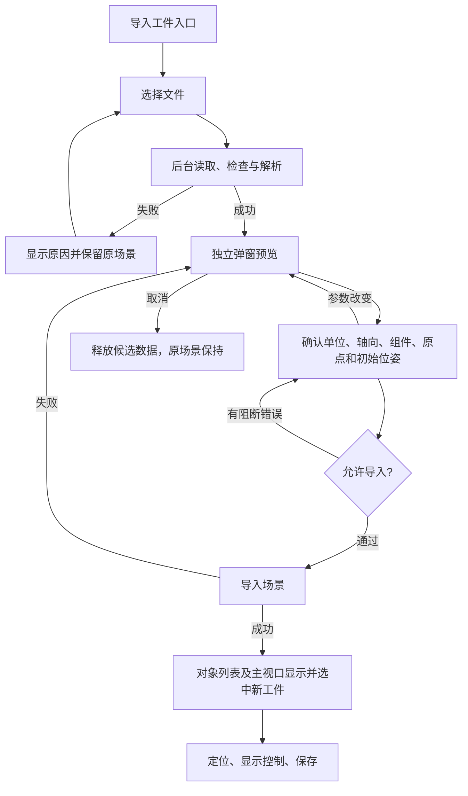

# 工件模型导入、预览与场景使用需求说明书

版本：V1.2 实施基线  
日期：2026-10-29  
适用项目：robot3d_demo  
用途：产品范围评审、交互设计、技术方案设计、开发拆分与验收依据。
修订说明：V1.2 记录用户确认按完整 P0 实施，并明确 OCCT/XDE 的必要传递依赖。

## 1. 需求结论与确认状态

本功能应提供完整的业务闭环：**选择工件文件 → 解析与检查 → 在独立弹窗预览 → 确认单位、方向及初始位置 → 导入当前机械臂场景 → 管理和定位工件 → 保存并恢复**。

| 项目 | 当前结论 | 状态 |
| --- | --- | --- |
| 文件范围 | STEP/STP、IGES/IGS、STL、OBJ、PLY，包含三维 CAD 与三维网格 | 用户已确认，首期必需 |
| CAD 技术依赖 | 引入 OCCT 负责 STEP/IGES 解析及曲面离散，接入现有 OpenGL/VTK 场景 | 用户已确认引入；固定版本和部署方案待验证 |
| 预览方式 | 独立弹窗，确认后才加入当前机械臂场景 | 用户已提出 |
| 首期使用深度 | 覆盖场景管理、精确定位、显示控制、撤销重做、保存恢复 | 用户已确认按完整 P0 实施 |
| 表面点选、轨迹关联 | 留待后续阶段，本文定义必要的衔接规则 | 用户已确认不纳入首期 |
| 碰撞、可达性、自动路径 | 独立计算能力，留待后续阶段 | 用户已确认不纳入首期 |
| 性能和容量指标 | 第 12 节给出可测量的建议目标 | 待基准评估后冻结 |

本文的“必须”表示对应交付阶段的验收要求；P0 为建议首期发布门槛，P1 为后续增强，P2 为独立扩展模块。“待确认”项不应在开发排期时被当作用户已批准的范围。本文描述目标需求，项目现有能力见第 3 节。

## 2. 业务目标、用户与范围

### 2.1 业务目标

1. 用户能够确认工件文件是否选对、几何是否完整、尺寸与方向是否正确，再把工件加入场景。
2. 工件能够与机械臂按真实物理比例共同显示，并通过明确的坐标系和数值位姿放置。
3. 多个工件可以独立管理，误操作可以恢复，关闭程序后能够继续使用已保存的工件场景。
4. 单位错误、模型损坏、资源缺失和大模型加载等情况有明确反馈，不破坏当前场景。
5. 保留工件身份、局部坐标及来源信息，为后续测量、轨迹、碰撞等模块提供可靠引用。

### 2.2 典型用户与任务

| 用户 | 典型任务 | 完成判断 |
| --- | --- | --- |
| 工艺/应用工程师 | 导入零件，核对尺寸，放到机器人工作区域 | 工件比例、方向和位置符合预期 |
| 仿真/调试人员 | 同时配置工件、夹具等多个对象 | 对象可区分、独立管理，并随场景恢复 |
| 现场操作人员 | 打开既有工件场景，显隐和定位观察 | 无需重新寻找原文件或重复定位 |

首期将工件、夹具和工装统一视为可管理的静态模型对象；对象类别是描述信息，不自动赋予碰撞体、机器人负载或加工属性。

### 2.3 分期范围

| 能力 | P0：首期建议基线 | P1：增强 | P2：独立模块 |
| --- | --- | --- | --- |
| 文件读取 | 五类已确认格式、格式内约定的几何子集、诊断信息 | 批量导入、更多格式 | 原生 CAD 格式插件 |
| 预览 | 独立窗口、装配结构、视角操作、尺寸/单位、实体/线框 | 剖切、贴图、预览截图 | CAD 几何编辑 |
| 坐标与放置 | 单位/轴向转换、原点选项、父坐标系、数值位姿 | 操纵器、吸附、三点对齐 | 工件标定、视觉配准 |
| 场景管理 | 多实例、选择、显隐、锁定、重命名、删除、撤销重做 | 复制、分组、替换模型、子组件独立操作 | 动态装夹/抓取切换 |
| 持久化 | 可迁移的工件场景包、完整性校验、失败保护 | 外部引用、工件库、版本管理 | 协同资源管理 |
| 工程使用 | 真实比例与稳定工件身份、可读取的局部坐标变换 | 测量、表面点选、工件坐标系创建、轨迹绑定 | 碰撞、可达性、自动加工路径 |

首期不包含二维 DWG/DXF/PDF 图纸导入、尺寸标注识别、PMI 语义解析、CAD 建模/修补、NC 程序生成、机器人在线运动控制。若后续确认扩大“使用”深度，需同步调整对应需求和验收范围。

## 3. 当前项目基础与缺口

以下结论来自当前仓库的只读核查，用于约束方案设计。

| 方面    | 当前情况                                          | 对本需求的影响                   |
| ----- | --------------------------------------------- | ------------------------- |
| 框架    | Qt Widgets、MVP、应用服务、统一场景快照，OpenGL 与可选 VTK 双后端 | 新业务应通过应用层和场景契约接入          |
| 机器人模型 | 固定机型 OBJ 资源；CPU 网格提取与两种后端渲染已有基础               | 可复用部分解析/渲染经验，仍需通用工件数据契约   |
| 工件显示  | 现有末端工件开关关联固定模型资源，场景快照没有通用工件集合                 | 新增资产、实例、坐标绑定与对象管理         |
| 点云预览  | 独立弹窗、后台加载、失败保留旧数据，依赖 VTK                      | 可复用交互经验；点云未导入机械臂场景        |
| PLY   | 当前点云读取只消费顶点和颜色，忽略面拓扑                          | 工件 PLY 必须走网格解析，不能复用点云结果代替 |
| 长度    | 业务层使用 mm；渲染使用 0.04 的统一比例                      | 工件先归一化为 mm，渲染比例只应用一次      |
| 姿态    | 领域为 ZYX 欧拉角；旧渲染适配存在轴角历史语义                     | 新工件变换必须有独立、明确的数学契约        |
| CAD   | 未发现 STEP/IGES 专用导入、CAD 曲面离散和相关验收              | 已确定引入 OCCT；须补齐并验证 CAD 解析链  |
| 保存    | 当前有导帧及附带 JSON 快照，未发现工程级恢复流程                   | 工件持久化是本功能的新交付项            |

核查入口：[项目说明](../README.md)、[模型加载器](../src/robot3d/rendering/RobotMeshLoader.cpp)、[场景契约](../include/robot3d/scene/RobotSceneSnapshot.h)、[单位约定](../include/robot3d/rendering/SceneUnits.h)、[点云查看器](VTK点云查看器.md)、[双后端说明](VTK双渲染后端使用说明.md)。

## 4. 核心概念与业务规则

| 概念    | 定义与规则                                   |
| ----- | --------------------------------------- |
| 源文件   | 用户选择的文件及其必要依赖，全流程只读，不覆盖、不改写             |
| 工件资产  | 某一版本源文件解析后的不可变几何、层级、元数据、单位/轴向归一化信息与来源快照 |
| 工件实例  | 资产在当前场景中的一次使用，具有独立 ID、名称、位姿、显隐、锁定及显示属性  |
| 预览会话  | 尚未提交的候选资产、导入参数和加载任务，不能直接写入正式场景          |
| 父坐标系  | 工件位姿所依附的世界、机器人基座或静态命名坐标系，使用稳定 ID 引用     |
| 局部坐标系 | 工件归一化后的模型坐标系，作为实例定位与后续关联的基础             |
| 工件场景包 | 保存本功能状态和资产的自包含文件/目录包；具体后缀由技术设计确定        |

必须遵守以下规则：

- **一个资产可以对应多个实例。** 移动、隐藏或删除某个实例不影响其他实例；相同几何可以共享存储。
- **预览通过不等于已经导入。** 只有用户点击“导入场景”且提交成功后，才形成正式实例。
- **观察操作只改变相机。** 适应窗口、视角复位和相机旋转不得改变模型坐标、尺寸或位姿。
- **完整提交或完整回滚。** 工件几何、元数据、列表条目和实例状态必须一起生效，不能留下半成品。
- **显示成功只说明可显示。** 封闭性、工程精度、碰撞可用性和轨迹可用性分别具有独立检查和验收。
- **查看坐标系不改变父坐标系。** 主界面切换观察/Jog 坐标系不得重新绑定或移动工件。
- **导入与定位不驱动机械臂。** 本功能的动作不得修改机器人关节、TCP 定义或发出运动命令。

## 5. 完整用户流程与状态

### 5.1 标准流程



1. 主界面提供明确的“导入工件…”入口，对象管理区域也可进入同一流程。
2. 弹窗通过文件选择器或完整路径选择一个文件；P0 每次处理一个主文件，允许连续多次导入。
3. 用户点击“加载预览”，系统读取文件与必要依赖，检查几何并生成预览。
4. 用户核对模型、组件、实际尺寸、单位和警告，设置原点、父坐标系及初始位姿。
5. 只有当前预览与当前文件/参数一致，且无阻断错误时，“导入场景”可用。
6. 点击后锁定本次提交，准备当前后端资源并原子新增实例；失败时保留可重试的预览。
7. 成功后关闭弹窗，在对象列表选中新实例，并给出定位观察入口；不无条件重置主视角。
8. 用户通过属性区调整工件，保存工件场景包，后续打开时恢复。

### 5.2 界面状态与允许动作

| 状态 | 允许动作 | “导入场景” |
| --- | --- | --- |
| 未选文件 | 选择文件、取消 | 禁用 |
| 已选未加载 | 加载、重新选择、取消 | 禁用 |
| 读取/解析/离散中 | 取消加载、取消弹窗；切换文件按新任务处理 | 禁用 |
| 预览就绪 | 观察、调整参数、重新选择/加载、导入、取消 | 检查通过后启用 |
| 存在非阻断警告 | 查看详情、调整、重新加载、导入 | 允许，提交摘要保留警告 |
| 存在阻断错误 | 查看原因、修改参数、重新选择/加载 | 禁用 |
| 导入提交中 | 查看进度 | 禁用，禁止重复提交 |
| 导入成功 | 返回主场景操作 | 不再接受同一次会话提交 |
| 导入失败 | 重试、调整、取消 | 恢复到当前候选的合法状态 |

IM-01：加载任务具有会话和版本标识。加载 A 时切换到 B，A 的结果不得覆盖 B 的预览；关闭窗口后不得回写已销毁对象。

IM-02：切换文件后可以暂时保留上次成功模型供观察，但必须标注“上次预览：文件 A；文件 B 尚未就绪”，并禁用导入，防止提交错误文件。

IM-03：关闭弹窗、点击取消和按 Esc 均取消未提交会话。取消立即有反馈；旧任务结束后释放资源，且不得向场景补入工件。提交阶段需要短暂禁止关闭；阶段结束后恢复可操作状态。

IM-04：每个预览会话最多产生一次成功提交；双击按钮、快捷键重复或异步回调重复不得创建重复实例。

## 6. 文件读取、格式与质量要求

### 6.1 首期支持矩阵

以下为目标支持边界，最终发布说明必须与验收样本一致。不能仅根据扩展名或通用解析库名称宣称支持。

| 格式 | P0 必须支持的内容 | 边界与提示 |
| --- | --- | --- |
| STEP / STP | AP203、AP214、AP242 的基础 B-rep 实体/曲面几何；平面、圆柱、圆锥、球、圆环、B 样条/NURBS 及裁剪面；单零件、多实体、文件内装配、组件变换及长度单位 | AP242 的 PMI、GD&T、运动关系和全部业务语义不在 P0；不能将“支持 AP242 几何子集”表述为完整协议支持 |
| IGES / IGS | 以 IGES 5.3 为首期版本基线的三维实体、解析曲面、B 样条/NURBS 及裁剪曲面；模型单位和多实体 | 纯二维线图、仅曲线/线框且无可显示表面不作为工件实体成功导入；遇不支持实体需说明 |
| STL | ASCII、二进制三角网格，正确顶点/法向及面拓扑 | 不依赖非标准颜色扩展；无法确认单位时必须由用户选择 |
| OBJ | 顶点、有效面、多边形三角化、组/对象及 MTL 基础漫反射色 | UV 可保留；贴图显示为 P1。缺失 MTL/贴图可用统一颜色降级，并报告 |
| PLY | ASCII、binary little endian、binary big endian 的顶点与面；常见顶点 RGB | 必须读取面拓扑；仅有顶点的文件提示“点云 PLY”，建议使用点云查看器，禁止悄然当实体工件导入 |

预研必须冻结 CAD 兼容清单，逐项列出协议/文件版本、支持的几何实体和装配组织方式、已知不支持内容及对应黄金样本。该清单必须覆盖本表的首期目标，减少目标需重新评审；不得用“库能解析的内容”作为支持边界，也不得以少数文件打开成功宣称完整协议支持。

FMT-01：扩展名大小写不敏感，支持中文、空格和常见 Unicode 路径；允许读取只读文件。路径不可访问、权限不足、超出平台路径能力时给出可操作提示。网络路径可尝试读取，断连时必须可取消并保留原场景。

FMT-02：识别文件实际内容并校验头部。扩展名与内容不一致时显示识别结果；无法确定解析器或不在支持范围时阻止导入，不通过更改后缀“修复”。

FMT-03：装配及多实体文件必须显示组件数量、层级、名称和局部变换；默认选中全部可导入组件，允许取消选中部分组件，至少保留一个有效表面组件。首期作为一个场景实例导入，保留内部层级，子组件不独立移动。

FMT-04：所选导入组件及其必要依赖存在几何缺失、节点变换异常或不支持的几何时，P0 阻止导入并列出受影响组件。用户明确未选中的组件可排除，但须记录排除项及其中的已知问题；系统不能自动取消勾选来规避错误。若文件无法完整解析，不能可靠隔离坏组件，整次加载失败。仅不支持注释、PMI、贴图等非几何内容时允许降级并报告。

FMT-05：解析依赖以源文件目录和合法相对引用为基础；外部几何引用需要显式列出并定位。不得自动从互联网下载依赖，不执行模型携带的脚本，不覆盖同名本地文件。

FMT-06：源文件和依赖应在加载阶段形成一致快照。读取期间被修改、截断或无法完整读取时，本次加载失败。预览就绪后源文件改变/被移走，应说明“当前预览是已读取版本”，允许用户明确选择导入该快照或重新加载；不得静默改成另一个版本。

### 6.2 CAD 离散与几何保留

CAD-01：CAD 原始几何与用于显示的三角网格应区分保存；记录原始格式、单位、组件变换及离散参数。P0 通过保留原始 CAD 文件及必要依赖快照满足原始几何保存要求，不要求另行序列化解析内核的 B-rep。源快照用于将来重新离散和工程计算，不因此承诺当前具备精确几何查询能力。

CAD-02：首期提供“快速/标准/精细”三档离散质量，建议弦高公差分别为 0.5 / 0.1 / 0.02 mm，角度公差分别为 30° / 15° / 10°，默认标准。公差含义、单位和可能增加的耗时/面数应可见。具体参数经样本验证后冻结。

CAD-03：更改质量重新生成当前候选网格；重新生成完成前禁止导入。正式场景使用与已确认预览相同的几何版本和参数，不得导入时另用低精度模型而不说明。

CAD-04：保留文件可提供的组件/表面基础颜色；无法保留时列入兼容性说明。开放曲面可作为表面模型显示，并标注“非封闭实体”；不把不可计算体积视为显示失败。

### 6.3 质量检查和处置

| 问题 | 首期处置 |
| --- | --- |
| 文件为空、解析失败、没有有效表面、无可用顶点/索引 | 阻止导入 |
| 坐标含 NaN/Inf、越界索引、无效节点变换、无法可靠确定几何范围 | 阻止导入；说明组件和原因 |
| 全部面退化 | 阻止导入 |
| 少量零面积/重复三角面 | 可跳过无效面，给出原面数、跳过数及最终面数；有效表面仍须完整可辨 |
| 法向缺失 | 可自动生成并报告；不能凭此改变几何坐标 |
| 非封闭、非流形、可能自交 | 警告并允许显示；不得显示“适合碰撞/加工”结论 |
| 颜色/材质信息缺失 | 使用默认中性颜色，说明降级情况 |
| 尺寸极小、极大、距参考原点很远 | 显示尺寸/坐标风险提示，要求核对单位；超过资源或数值边界时阻止 |
| 超出容量、内存或显存不足 | 安全终止，提示上限和建议处理方式，保留原场景 |

P0 必做检查包括：有限坐标、索引合法性、有效表面、退化面、节点变换、依赖完整性及容量限制。封闭性、非流形和自交等检查按实际执行情况报告；全量自交/实体有效性检查为后续增强，未执行时必须显示“未检查”，不能显示通过或适合工程计算。

QLT-01：每次加载生成检查摘要，区分错误与警告，包含受影响组件、计数和建议操作。警告随资产保存，用户可在导入后再次查看。

QLT-02：P0 不静默执行额外的曲面缝合、补洞、删除正常组件或改变工程形状等修复。允许读取器在受控配置下进行格式转换所需的基础容差处理/shape healing；记录读取配置、容差及可获取的修复诊断，无法可靠转换时报告失败。需要额外改变工程几何的修复属于后续独立能力，不以“导入成功”为由自动执行。

### 6.4 Open CASCADE（OCCT）引入要求（P0）

首期采用 **Open CASCADE Technology（OCCT）作为 STEP/IGES 的 CAD 解析与几何处理依赖**，承担源几何读取、扩展属性提取和显示网格离散。引入 OCCT 已由用户确认，具体版本与部署方案须经过下述验证后冻结。

#### 6.4.1 职责与接入边界

| 环节 | 首期责任划分 |
| --- | --- |
| STEP/STP、IGES/IGS | OCCT 读取几何、拓扑与单位，提取文件实际提供的组件、名称和基础颜色 |
| CAD 扩展数据 | 使用 XDE/XCAF 组织装配引用、实例位置及属性；STEP 优先采用 STEPCAFControl_Reader，IGES 优先采用 IGESCAFControl_Reader |
| 曲面离散 | OCCT 根据第 6.2 节质量参数生成显示三角网格，输出组件/表面与网格之间的对应关系 |
| STL、OBJ、PLY | 沿用并扩展现有 Assimp 或专用网格读取适配器；按第 6.1 节独立验收，不强制转换为 CAD 实体 |
| 统一工件资产 | 项目自己的资产模块接收规范化几何、层级、物理单位、来源和诊断信息，管理资产版本与场景实例 |
| 预览与主场景 | 沿用 Qt 界面与 OpenGL/VTK 渲染；两后端消费同一份工件资产 |
| 后续工程计算 | 按第 11 节另行定义；OCCT 的引入不自动形成碰撞、可达性或加工路径功能 |

OCC-01：首期必须打通“STEP/IGES → OCCT 解析及离散 → 统一工件资产 → 独立预览/正式场景”链路。首期不引入 OCCT 自带查看器作为新的渲染后端，不要求改造既有机器人显示链。

OCC-02：必须正确遍历装配和多实体，处理形状定义与组件实例的复用、嵌套位置、面方向和颜色继承。IGES 等文件只能保留其实际提供的信息，不凭空补造装配语义；不能仅取第一个形状或将全部子对象无条件摊平成一个无来源网格。

OCC-03：OCCT 对象封装在 CAD 解析/几何适配层，domain/application 和统一场景接口不得直接依赖 TopoDS、XCAF 等具体类型。输出至少包含双精度物理坐标、面索引、法向、颜色、组件层级/实例变换、单位与归一化信息、源组件/面的映射及诊断。映射标识在同一资产版本内稳定；重新读取或重新离散后，仍按 USE-03 处理引用，不承诺面序号跨版本稳定。现有仅含扁平顶点的 CpuRobotMesh 不能直接作为完整工件数据契约。

OCC-04：按依赖闭包裁剪构建，引入 CAD 数据交换、模型数据、离散算法及 XDE 所必需的基础/应用框架组件。OCCT 7.9.1 的 XDE 会传递依赖 TKService、TKV3d、TKVCAF 等基础库，允许构建和部署这些必要依赖；不启用 OCCT 自带查看器、TKOpenGl 渲染驱动、DRAW 或 Qt 示例。所选版本的实际依赖以构建和运行验证为准，不通过删除必要 DLL/资源来缩减安装包。

#### 6.4.2 版本、编译与部署

OCC-05：以 **OCCT 7.9.1 固定版本作为首选预研候选**，验证当前 Qt 5.9.9、MSVC2015 v140 x64、C++11 工程的接入。官方该 tag 的构建说明列出 C++11、VS2015，顶层 CMake 也允许 C++11；**本项目尚未完成该版本的本机编译、链接和 CAD 样本验证，因此不将其标为最终通过版本**。不能笼统写“7.9.x 均兼容”，必须锁定具体 tag/提交和源码校验值，并以该版本实际源码约束为准。

- 优先采用与主程序匹配的 v140 x64 动态库；Debug/Release 分别验证运行库、导入库、DLL 和资源配置。
- OCCT 依赖路径与输出位置通过可复现的构建/部署配置管理，发布运行不依赖开发机全局 PATH 或手工安装目录。
- 若候选无法达到兼容性、取消或稳定性要求，先形成问题记录，再评审其他固定版本或独立 CAD 解析进程；不得未经评审升级整个项目工具链或降低五类格式要求。
- 依赖锁定清单包含 OCCT 版本/提交、来源、源码散列、补丁、构建选项、编译器/运行库、所需 DLL/资源以及第三方依赖版本。

OCC-06：OCCT 读取、转换、离散和资源释放纳入第 5 节的任务状态机，执行后台加载、版本隔离、进度、取消及失败回滚。存在全局解析参数或共享状态时，应隔离会话或受控串行访问；不得让不同预览任务互相改变单位、容差或离散结果。错误与可获取的容差/基础修复信息纳入统一质量报告；额外改变工程几何的修复受 QLT-02 限制。

OCC-07：预览和导入使用同一份已确认的离散结果，OpenGL/VTK 不分别重新解析 CAD。持久化记录 OCCT/适配器版本、读取配置及离散参数；保留源 CAD 与依赖快照即可满足 P0 的原始几何保存，不额外要求序列化 OCCT 内核对象。解析器升级或缓存失效后的重新生成必须沿用已确认参数，并重新执行检查。

OCC-08：交付包含 OCCT 必需 DLL/资源的部署验证、透明加密环境读取验证，以及许可证和商用分发评审材料。按所选版本的 LGPL 2.1 附加例外及其第三方组件许可形成发布清单；动态链接方式不能代替许可评审。依赖初始化失败、DLL/资源缺失或 CAD 解析不可用时，应提供可识别诊断并保持原场景；缺少首期 CAD 能力的包不能作为完整功能版本验收通过。

#### 6.4.3 选型依据与验证状态

- [OCCT 7.9.1 官方构建说明](https://raw.githubusercontent.com/Open-Cascade-SAS/OCCT/V7_9_1/dox/build/build_occt/building_occt.md)：声明 C++11 和 Visual Studio 2015 及以上。
- [OCCT 7.9.1 官方 CMake](https://raw.githubusercontent.com/Open-Cascade-SAS/OCCT/V7_9_1/CMakeLists.txt)：实际允许选择 C++11；用于与说明文档交叉核对。
- [OCCT XDE 官方说明](https://raw.githubusercontent.com/Open-Cascade-SAS/OCCT/V7_9_3/dox/user_guides/xde/xde.md)：说明 STEP/IGES 扩展数据、装配、名称与颜色能力；最终兼容性按所选版本样本验收。
- [OCCT 官方许可说明](https://www.occt3d.com/dev/doc/overview/html/occt_public_license.html)：发布评审的依据之一，以实际交付版本附带许可为准。

上述来源用于技术选型，不构成本项目已完成编译、格式兼容、性能或许可评审的结论。

## 7. 预览弹窗交互要求

### 7.1 布局建议

```text
┌ 工件模型导入 ─────────────────────────────────────────────────┐
│ 文件路径 [                                ] [选择] [加载预览] │
├ 结构树/组件 ─────┬ 三维预览区 ──────────────┬ 信息与导入参数 ──┤
│ 根节点/装配     │                          │ 格式、单位来源   │
│ ☑ 零件 A      │  独立相机、坐标轴         │ 尺寸、组件/面数  │
│ ☑ 零件 B      │  包围盒、标准视角         │ 轴向/原点/质量   │
│               │                          │ 名称/父系/位姿   │
├────────────────┴──────────────────────────┴──────────────────┤
│ 加载阶段、进度、错误/警告摘要与详情                            │
│                                      [取消] [导入场景]       │
└──────────────────────────────────────────────────────────────┘
```

PRV-01：窗口可调整大小；建议默认 1100×760，按屏幕可用区域收缩，最低适配 1366×768、100%/125%/150% DPI。低分辨率下参数区可滚动，关键按钮不得被遮挡。鼠标操作、快捷键和工具提示应与现有主视口保持一致；有差异时给出明确提示。

PRV-02：必须提供旋转、平移、缩放、适应窗口、复位视角、前/后/左/右/上/下及等轴测视角。首次成功加载自动适应所选组件整体范围，裁剪面随尺寸调整。

PRV-03：显示坐标轴及 X/Y/Z 标签；包围盒和长宽高可开关。区分“文件原始尺寸”和“转换后尺寸”，转换后统一标注 mm。

PRV-04：提供实体、线框、实体带边线三种显示方式，以及文件基础颜色/统一颜色、双面观察开关。默认实体带边线；显示方式不能改变面拓扑或导入精度。

PRV-05：显示文件名、规范化路径、实际格式、源文件大小、单位及来源、转换后包围盒、组件数、顶点数、三角面数、是否封闭/是否未知、离散质量及警告数量。未执行的检查显示“未检查”，不能用绿色通过代替。

PRV-06：点击结构树能高亮对应组件并定位观察；取消组件导入后，以明确状态区分“未选中”和“加载失败”。在预览中临时隐藏组件只影响观察；“是否导入”由独立勾选项决定。

PRV-07：显示读取、解析、离散、检查、准备预览等阶段。有可靠总量时显示百分比，否则显示阶段与已耗时，不编造进度。错误信息在窗口内持续可见，详情可复制。

PRV-08：预览和正式场景必须共享同一套归一化数据和物体变换规则。弹窗相机独立，关闭或操作预览不得改变主场景的相机和机器人状态。

## 8. 单位、坐标、原点和位姿

### 8.1 单位与模型方向

TRN-01：工件业务坐标统一为 **mm，右手坐标系，Z 向上**；角度在界面用 °。源单位可选择 mm、cm、m、in，并提供明确标注的自定义正比例换算。自定义值必须为有限正数，P0 不支持非等比或负比例缩放。

TRN-02：有可信单位元数据时自动填写并显示来源；用户可以显式覆盖并保留记录。无可靠单位时显示“未知”，要求用户主动选择；不得仅凭文件后缀或包围盒大小静默认定 mm。可以建议上次设置，但仍须用户确认未知单位。

TRN-03：单位换算后实时更新实际尺寸；例：0.1 m 的边应显示 100 mm。修改显示缩放或相机距离不得改变该尺寸。

TRN-04：允许设置源模型上方向（±X/±Y/±Z）和前方向，两轴不得平行；能确认坐标约定时自动填写并显示来源，不能确认时使用明确显示、可修改的导入约定。支持显式左/右手系转换；发生反射时须同步调整面绕序与法向，禁止造成镜像误读或单面消失。

TRN-05：装配节点的局部变换和单位必须正确累积；含不同单位的组件需统一到 mm。坐标转换和场景 0.04 的渲染比例不得重复应用。

### 8.2 原点与初始放置

TRN-06：默认保留源模型原点；可选择“包围盒中心”或“底面中心”作为工件局部原点。底面中心指完成轴向转换后包围盒的 (中心 X，中心 Y，最小 Z)，是定位辅助点，不表示真实接触面。原点重定义要保存偏移并更新预览轴，不修改源文件。

TRN-07：首期父坐标系支持世界坐标系、当前机器人基坐标系及可解析的静态用户/工件坐标系。默认当前机器人基坐标系，初始 XYZ/Rx/Ry/Rz 均为零；在弹窗明确显示“工件原点放到所选父坐标系原点”，不自动猜测工作台位置。

TRN-08：用户输入 X/Y/Z、Rx/Ry/Rz。位置为 mm，姿态采用 **R = Rz(Rz) × Ry(Ry) × Rx(Rx)** 的 ZYX 欧拉角约定、右手正方向，角度定义相对于所选父坐标系。P0 采用绝对数值位姿编辑，不混入局部增量旋转。界面提供零位复位和应用前/后的尺寸与位姿摘要。

TRN-09：内部持久化采用无歧义的双精度平移和单位四元数/刚体矩阵；记录坐标约定。显示欧拉角等效转换可能产生数值变化时，实际姿态不得跳变，接近奇异姿态时可提示但不损坏变换。

变换契约为：

```text
p_world = T_world_parent × T_parent_workpiece × N_source_to_local × p_source
```

其中 N 包含单位、轴向和局部原点偏移，T_parent_workpiece 是用户编辑的刚体位姿；渲染统一比例由后端在物理变换之后应用。文件内组件节点变换必须在进入此链前正确组合。

TRN-10：更换父坐标系时，默认保持工件世界位置不变，并重新计算数值位姿；若用户选择“保持相对位姿”，应明确预览其将改变世界位置。不得依赖当前观察坐标系隐式决定。

TRN-11：同一模型的单位或轴向归一化完成后，在首期场景属性中只读；修正需重新进入导入预览。普通移动/旋转不得偷偷改变资产尺寸。

### 8.3 父坐标与机器人状态变化

- 世界绑定工件不随机械臂关节变化移动；基座绑定工件只随基座安装变换变化，不随关节链运动。
- 静态命名坐标系发生定义变更时，其绑定工件按该父系更新；操作前列出受影响工件，并可撤销。
- 删除/失效父坐标系或切换机型导致引用不可解析时，不允许静默回到原点。首期采用转换为世界绑定、保持原世界位姿并标注“原父坐标失效”，由用户重新关联；此转换写入撤销记录。
- P0 不支持工件绑定工具/TCP 并跟随机械臂末端运动；抓取、释放、换父系及闭环装夹属于后续动态场景能力。
- 工件模型不自动创建、修改或覆盖现有 Jog/机器人控制坐标系。创建可供工艺使用的工件坐标系属于第 11 节增强项。

## 9. 当前场景中的管理与显示

SCN-01：新增工件对象列表/树，与机器人类别清楚区分。每个实例显示名称、类型、显隐、锁定和异常状态；名称默认源文件名，重名追加“(2)”“(3)”等序号。内部使用稳定 ID，改名不改变引用；名称支持中文且不能为空。

SCN-02：支持列表单选和三维单击选择，二者联动。重叠时选择视线最近的可选可见工件；透明、线框和选中高亮不应导致选择对象与显示对象错位。空白处取消选择；列表提供定位观察以处理完全遮挡对象。

SCN-03：支持显示/隐藏、统一颜色、透明度、实体/线框/带边线、局部坐标轴、定位观察。隐藏工件不参与视口拾取和适应可见对象范围，但可以在列表中选择及重新显示。透明只属于显示属性，不改变几何或未来计算语义。

SCN-04：锁定保护位姿和删除，仍允许选择、查看属性和显隐。修改或删除锁定工件时说明应先解锁。锁定状态不能被快捷键或右键菜单绕过。

SCN-05：属性区显示来源、格式、单位、尺寸、组件、警告、父坐标系和位姿；允许重命名及调整合法数值位姿。输入非法数值不提交，编辑一组位姿作为一次可撤销操作。

SCN-06：支持删除实例；删除后清理选中状态及临时高亮，其他实例和机器人保持。有后续业务引用时必须执行第 11 节的引用失效规则。最后一个实例删除后，在未被撤销历史使用时释放其资产资源。

SCN-07：导入、删除、改名、位姿/父系修改、锁定及显示属性变更支持撤销/重做；至少保留本次会话最近 20 次已提交对象操作。观察相机和临时选择不计入业务撤销。重新打开场景后不要求保留历史。

SCN-08：重复导入同一资产时明确显示“将新增工件实例”，默认新建，不覆盖原实例。资产共享不得使实例位姿、颜色或显隐互相影响。P0 不进行自动替换或热更新。

SCN-09：工件导入和调整不清空路点、轨迹、安全面或现有工具模型；全局“末端工具/工件”旧开关不得误控制新工件。切换机型按第 8 节处理父系引用。

SCN-10：导入后主相机默认保留，提供“定位新工件”和“适应全部可见对象”。工件在当前视野外时，状态区明确提示并提供定位动作。相机裁剪范围应容纳可见工件和机械臂，不能通过修改物理比例解决看不见的问题。

SCN-11：启用双后端时，OpenGL/VTK 切换保留工件数量、ID、位姿、显隐、选中、显示属性和相机。目标后端资源准备失败时保留原后端和全部场景状态。允许光照和抗锯齿差异，不允许几何、尺寸或组件丢失。

SCN-12：仅 OpenGL 构建也必须具备首期核心工件导入、预览、管理和保存能力。不能沿用“点云查看器需 VTK”限制而使本功能整体不可用；具体预览后端由方案设计决定。

## 10. 保存、恢复与资源完整性

DAT-01：鉴于项目尚无完整工程文件，首期至少新增“保存工件场景…”和“打开工件场景…”能力，形成独立可用闭环。未来可并入总工程系统；本期不要求恢复机器人完整程序、实时关节或运动状态。

DAT-02：默认使用自包含场景包，保存必要源资产快照、几何依赖、规范化显示网格和元数据。包搬迁到另一目录或原文件移走后仍应恢复，不只保存原绝对路径。相同资产只存一份；内部资源使用相对位置并带完整性校验。

DAT-03：必须保存：格式版本、资产/实例稳定 ID、来源路径与内容指纹、支持的格式/解析及离散参数、单位与方向、局部原点定义、装配结构及组件选择、实例父系引用及世界位姿备份、名称、类别、显示与锁定属性、警告摘要。相机可随包保存，但恢复时不得改变工件物理位姿。

DAT-04：保存当前机器人型号与基座世界位姿作为上下文校验信息。打开时若当前机械臂上下文不同，列出差异并由用户选择保持保存的世界位置或重新绑定当前父系；不得自动切换机型、修改关节或移动机械臂。

DAT-05：“打开”前说明是替换当前工件集合；当前工件有未保存修改时，提供保存后打开/放弃并打开/取消。取消保持当前集合。合并导入场景包为 P1；普通单文件导入始终是新增实例。

DAT-06：先完整校验和准备候选包，再替换当前工件集合。包损坏、版本不支持、资源缺失、校验不匹配或后端准备失败时，保留原工件场景。无法解析的父坐标系按第 8 节规则处理并在提交前列明。

DAT-07：保存采用临时写入、完整性验证后替换目标文件；磁盘不足、无权限或中断时不损坏已有有效场景包。窗口关闭/程序退出检测工件未保存状态；保存失败不能等同于已保存。

DAT-08：规范化网格缓存失效时，能够用包内源快照重新生成，并说明原因；不静默改变已确认的单位或离散质量。仅包含缓存、源几何不完整的包应明确标注其恢复能力，不能伪装为完整自包含包。

DAT-09：模型源文件与既有项目资源始终只读。本机透明加密环境下，应通过获准读取的程序/部署配置获取内容；读取到加密头或无权限时报告可识别错误，不把密文当作损坏几何进行修复。缓存、临时文件和导出包遵守企业的加密/目录权限策略，不通过改扩展名制造不受控明文副本。

DAT-10：临时资产限于应用受控目录，不记录模型内容到日志；取消和失败清理临时数据，进程异常退出后可在下次启动清理过期会话。日志保留诊断码、阶段与资源统计，默认不上传文件或路径。

## 11. 后续“使用”能力及衔接规则

本节是范围选择依据，不作为用户已确认的首期承诺。

| 能力 | 建议阶段 | 独立需求和验收边界 |
| --- | --- | --- |
| 基础测量 | P1 | 点到点距离、坐标、包围尺寸；网格测量标注近似，CAD 精确测量需专用几何计算 |
| 表面选点 | P1 | 返回实例 ID、组件 ID、局部/世界点及法向；区分网格三角面与 CAD 原始曲面 |
| 工件坐标系建立 | P1 | 原点加方向、三点建系、数值定义；可校验、重命名和撤销；明确与控制器坐标系的映射 |
| 路点/轨迹关联 | P1 | 路点以工件局部坐标绑定稳定实例 ID；移动工件后按策略更新世界坐标，重新校验 |
| 参考位置对齐 | P1 | 三点/面/轴对齐、吸附，报告误差；不等同于实机标定 |
| 模型替换/重新加载 | P1 | 显式操作，保留实例身份和位姿前先预览尺寸/原点变化；旧拓扑引用失效需处理 |
| 静态/运动碰撞 | P2 | 定义参与对象、简化几何、距离阈值、采样精度与检测范围；显示显隐不决定参与计算 |
| 可达性分析 | P2 | 依赖机器人逆解、关节限制、工具、姿态约束等；不能仅凭工件处于视野内判断 |
| 自动生成加工路径 | P2 | 独立定义工艺、区域/曲线选择、刀具/工具姿态、间距、进退路径和质量检查 |
| 动态抓取与装夹 | P2 | 定义父系切换、抓取/释放时刻与位姿连续性；不能直接复用静态工件定位逻辑 |

USE-01：后续关联必须使用稳定实例 ID 和局部坐标，不能依赖对象名称、列表下标或文件绝对路径。

USE-02：工件移动后，关联路点/轨迹应按绑定关系重新计算世界位置，并标记“待重新验证”；不直接下发至机器人。工件隐藏不删除关联，删除时应阻止或明确解除引用，不能留下悬空对象。

USE-03：替换资产或重新离散导致组件/面标识变化时，既有表面引用须重新匹配或失效；不得凭相同面序号继续认为对应同一工程表面。

## 12. 非功能要求、容量与性能目标

以下数值是本需求稿提出的**建议发布目标，尚未进行实测**。技术预研结束后冻结基准机、测试集和上限；若无法达到，应在范围评审中调整，不能在开发中无说明降低已确认格式和核心闭环。

### 12.1 体验与性能口径

| 项目 | 建议目标 | 测量方法/条件 |
| --- | --- | --- |
| 基准环境 | Windows x64、至少 6 核 CPU、16 GB RAM、SSD、Iris Xe 级或更高 GPU | 实测时记录确切 CPU/GPU/驱动/系统/屏幕与视口尺寸，Release 构建 |
| 操作反馈 | 点击加载、取消、导入后 200 ms 内出现状态变化 | 从输入事件到可见反馈计时 |
| 加载期间响应 | 窗口可拖动、重绘和取消，UI 心跳间隔不超过 500 ms | 覆盖解析、CAD 离散、预览资源上传和保存 |
| 小型网格加载 | 不超过 10 万三角面、50 MiB，首次可交互完整预览 ≤ 5 s | 包含读取、校验、解析、归一化和首次绘制 |
| 标准网格加载 | 不超过 100 万三角面、256 MiB，完整预览 ≤ 15 s | 同上；单独记录峰值内存 |
| 标准 CAD 加载 | 主文件 ≤ 50 MiB、原始曲面 ≤ 5000、离散结果 ≤ 100 万三角面，标准质量 ≤ 30 s | STEP 与 IGES 分别测试，包含离散 |
| 正式提交 | 已预览的标准资产新增实例并完成主场景首帧 ≤ 2 s | 不重复读取/解析源文件；含当前后端资源准备 |
| 标准场景交互 | 机器人与可见工件合计 ≤ 100 万三角面、≤ 20 实例，拖动观察平均 ≥ 25 FPS | 固定 1000×700 视口、默认实体模式，OpenGL/VTK 分别记录 |
| 取消释放 | 200 ms 内反馈；可协作阶段 ≤ 2 s 停止并释放候选资源 | 不可协作阶段须在预研冻结受控隔离/终止方案及最长释放时限，并按该时限验收；未确定上限不得发布 |
| 内存 | 标准资产加载过程增量峰值建议 ≤ 1.5 GiB | 以已有机器人场景稳定后的进程内存为基线，含源快照与缓存 |
| 稳定性 | 连续 50 次导入→删除/关闭预览后无持续内存增长 | 允许有界缓存；清理后稳定值增量建议 ≤ 100 MiB，无崩溃/悬空实例 |

每类格式至少选 3 个不同结构样本，每样本运行至少 5 次，报告加载时间中位数/最大值、FPS 分布和峰值内存；上表加载时间目标以最大值核对。若报告 P95，每个样本须至少运行 20 次并说明统计方法。冷加载与缓存加载分开记录；冷加载不得使用已有解析缓存。首次驱动/着色器开销单独记录，不能从报告中隐去。

### 12.2 容量与超限策略

CAP-01：建议首期单主文件上限 512 MiB，单资产最多 500 万离散三角面，单场景最多 50 个工件实例，可见提交面数合计最多 1000 万；全部引用的不同资产三角面总量也最多 1000 万。装配及外部几何依赖合计建议上限 1 GiB。具体上限由基准结果冻结。

CAP-02：源文件大小、依赖大小、节点数、顶点数、面数、贴图/属性数组和实际内存分配均需设有限边界，检查整数溢出。无法预先获取的数量在解析过程中增量检查，不能读取完才发现超限。实例数和面数合规也不代表必须继续分配，资源不足时提前失败。

CAP-03：超过硬上限时阻止加载/提交并说明当前值、上限及建议；接近上限时提前警告。CAD 可建议改用快速质量，网格可建议外部减面；不得静默降低精度或删组件后仍声称完整导入。

CAP-04：较大模型可分阶段生成资源，但只有完整可用的候选才可提交。后台任务失败或取消必须释放 CPU/GPU 资源，不能让主场景成为补偿清理对象。

### 12.3 兼容性与可靠性

NFR-01：首期兼容当前 Qt 5.9.9、MSVC2015 v140 x64、C++11 工具链。若 CAD 依赖需要调整工具链/进程部署，必须在技术评审中明确兼容方案，不能推迟到功能验收时才暴露。

NFR-02：应用层资产、实例和坐标语义与具体渲染后端解耦；两后端消费相同的规范化几何与位姿，不分别解析出不同结果。文件读取在后台，GPU 对象在各自合法上下文创建/销毁。

NFR-03：正常显示、机器人模拟、机型切换、后端切换、窗口隐藏/恢复、退出程序均需覆盖工件生命周期。加载任务不得拖垮既有机器人交互。

NFR-04：数值输入校验有限值、合法范围及变换可逆性；持久化采用双精度物理坐标。固定基准件的尺寸/位置回归误差建议不超过 0.01 mm、旋转不超过 0.01°，渲染后端可按像素容差核对轮廓；该指标是软件变换一致性要求，不代表源网格或实机加工精度。

NFR-05：OCCT 按第 6.4 节完成固定版本、依赖裁剪、部署、许可证及商用分发评估；发布时附准确的格式兼容性说明和已知限制。五类格式仍分别验收，不能仅凭引入 OCCT 或现有 Assimp 包即认定格式能力已达标。

## 13. 关键异常与用户反馈

| 场景 | 系统行为与反馈 | 场景保护 |
| --- | --- | --- |
| 未选择文件、路径错误、无权限 | 指向具体路径/原因，提供重新选择入口 | 不新增对象 |
| 不支持的格式/格式内实体 | 显示识别格式与不支持内容，提供兼容格式建议 | 不悄然部分导入 |
| 解析损坏、截断、无有效面 | 显示错误摘要和诊断详情 | 保留原场景和上次有效预览的明确标识 |
| 单位未知/未确认 | 高亮单位栏，禁止导入 | 不自动猜定 |
| 材质或贴图缺失 | 警告，以默认颜色显示 | 几何完整时可继续 |
| 装配几何依赖缺失 | 列出组件与依赖路径，阻止导入 | 不产生缺件模型 |
| 文件读取中被修改/删除 | 停止本次加载，提示重新加载 | 无候选残留 |
| 预览后源文件变化 | 明确快照版本，选择导入已预览快照或重新加载 | 不偷换模型 |
| A/B 任务先后完成顺序相反 | 仅当前有效任务能更新预览 | 禁止旧版本提交 |
| GPU/内存不足、后端切换失败 | 释放候选，说明失败阶段和建议 | 保留原后端与原场景 |
| 工件远离场景/被遮挡 | 显示尺寸/位置提示，提供定位观察 | 不自动改尺寸或物理位置 |
| 场景包损坏、缺资源、版本不支持 | 校验失败并给出恢复建议 | 不替换当前工件集合 |
| 保存失败 | 保持未保存标识，允许换位置重试 | 已有有效包保持可打开 |

错误文案示例：“无法导入：该 PLY 只有顶点，没有有效面。请使用点云查看器，或导出包含面拓扑的模型。”  
警告文案示例：“缺少 2 个材质文件，几何已完整读取，将使用统一颜色显示。详情…”

## 14. 验收标准与样本集

### 14.1 功能验收

| 编号 | 情景/步骤 | 通过标准 | 对应要求 |
| --- | --- | --- | --- |
| AC-01 | 分别读取 STEP、IGES、STL、OBJ、PLY 的基准模型 | 五类格式均完成预览和主场景导入，几何/尺寸正确 | 第 6 节 |
| AC-02 | STEP AP203/AP214/AP242 几何子集及多实体/装配样本 | 受支持组件完整，层级/局部变换正确；不支持内容可解释 | FMT-03/04、CAD-01 |
| AC-03 | IGES 实体、开放曲面、裁剪曲面及不支持实体 | 正常曲面正确显示；不完整几何阻止导入；开放性有标识 | 第 6 节 |
| AC-04 | ASCII/二进制 STL，三类编码 PLY，OBJ 多边形/负索引样本 | 面拓扑完整、三角化正确，无只显示首组件或错连面 | 第 6 节 |
| AC-05 | 导入只有顶点的 PLY | 识别点云并阻止实体导入，给出查看器建议 | 支持矩阵 |
| AC-06 | 中文/空格路径、只读、网络断连/无权限 | 合法路径读取；失败信息清楚，原场景不变 | FMT-01 |
| AC-07 | 预览旋转、平移、缩放、六视图、适应窗口 | 模型可完整观察；相机操作不改变物理尺寸和位姿 | PRV-02/03、TRN-03 |
| AC-08 | 改单位、方向、离散质量和组件选择后导入 | 仅当前已完成预览版本可提交；预览与场景一致 | CAD-03、PRV-08 |
| AC-09 | 100 mm 与 0.1 m 的同一基准长方体；未知单位模型 | 两者场景尺寸均为 100 mm；未知单位未经确认不能导入 | TRN-01/02/03 |
| AC-10 | 不同上方向、左右手系及有面方向的基准件 | 方向、面绕序和法向正确；无意外镜像或表面消失 | TRN-04/05 |
| AC-11 | 非对称模型：XYZ=(100,200,300)，Rx/Ry/Rz=(30,45,60) | 用独立计算的矩阵核对不少于 4 个点，误差满足约定 | TRN-08/09、NFR-04 |
| AC-12 | 三种原点设置、切换父系、切换观察/Jog 坐标系 | 原点偏移可解释；保持世界位置选项准确；观察切换不移动物体 | 第 8 节 |
| AC-13 | 加载后取消、加载中关闭、A/B 交错回调 | 无实例残留、无旧模型覆盖、无关闭后回写或重复提交 | IM-01/02/03/04 |
| AC-14 | 相同文件重复导入两个实例，分别移动、隐藏、删除 | ID 不同，状态独立，删除一个不影响另一个 | SCN-01/08 |
| AC-15 | 列表/三维选择、遮挡、透明显示、锁定、非法数值 | 选择联动正确；锁定不能绕过；非法输入不提交 | SCN-02/03/04/05 |
| AC-16 | 导入/修改/删除连续撤销重做，覆盖至少 20 步 | 对象、位姿、显示、父系完整恢复，其他对象不受影响 | SCN-07 |
| AC-17 | 关节模拟、基座变化、机型切换和父系失效 | 按绑定规则运动/保持，失效不跳原点；机器人状态不被工件操作修改 | 第 8 节、SCN-09 |
| AC-18 | OpenGL 与 VTK 切换，目标后端故障 | 工件状态及视角保持；失败恢复旧后端和完整场景 | SCN-11 |
| AC-19 | 仅 OpenGL 构建运行完整导入、预览、管理、保存流程 | 核心功能可用，不因缺少 VTK 被整体禁用 | SCN-12 |
| AC-20 | 保存后移动源文件和场景包目录，重启后打开 | 资产、实例、归一化、显示和位置恢复，不依赖原绝对路径 | DAT-01/02/03 |
| AC-21 | 当前机械臂上下文不同；包损坏/版本错误/缺资源 | 提交前说明差异；失败不替换当前集合或改变机器人 | DAT-04/06 |
| AC-22 | 未保存时打开/退出；磁盘不足或无权限保存 | 提供保存/放弃/取消；失败保留有效包和未保存状态 | DAT-05/07 |
| AC-23 | 缺材质、缺几何依赖、退化面、NaN/Inf、坏索引 | 与质量表一致；降级有数量说明；阻断错误不能导入 | FMT-04、QLT-01 |
| AC-24 | 源文件加载中改变、预览后改变 | 前者加载失败；后者只可明确导入已预览快照或重载 | FMT-06 |
| AC-25 | 小/标准/超限模型、取消及连续 50 次生命周期 | 达到冻结后的性能目标，超限安全失败，资源有界释放 | 第 12 节 |
| AC-26 | 现有机型、关节/TCP、路点轨迹、工具、安全面、导帧回归 | 原能力不退化；工件操作不清空原数据或触发运动 | SCN-09、NFR-03 |
| AC-27 | 企业透明加密文件与受控临时/缓存目录 | 获准通道正常读取；无法读取时提示明确，源文件和受保护数据不被改写 | DAT-09/10 |
| AC-28 | 固定 OCCT 候选在当前 v140 x64/C++11 下构建，分别运行 Debug/Release | 主程序与 CAD 依赖正确链接/加载；版本、运行库及可复现构建记录齐全 | OCC-04/05 |
| AC-29 | 用含复用组件、嵌套变换、不同面方向/颜色的 CAD 样本完成导入 | 组件完整、位置/颜色正确，映射可追踪；两后端共享已预览网格，不重复解析 CAD | OCC-01/02/03/07 |
| AC-30 | CAD 读取/转换/离散中取消、任务交错、解析失败或异常退出会话 | 符合任务隔离和有界取消要求，无跨会话参数污染；原场景保持，候选资源释放 | OCC-06、第 5/12 节 |
| AC-31 | 在未安装开发 SDK 的目标环境部署，模拟 OCCT DLL/资源缺失 | 正常包独立运行；缺依赖时诊断明确且原场景保持；无 OCCT 查看器依赖，许可/依赖材料齐全 | OCC-04/05/08 |

### 14.2 验收样本要求

- 为每种格式提供至少一个已知尺寸的非对称零件，避免用球体掩盖轴向/镜像错误。
- STEP 包含三种协议几何样本、装配实例复用、嵌套变换及外部引用；IGES 包含裁剪曲面和开放曲面。
- STL 包含 ASCII/二进制、缺法向/退化面；OBJ 包含多组/多边形/负索引/缺 MTL；PLY 包含三种编码、含面与仅点两类。
- 提供 mm/m/in 等单位版本、无单位版本、不同轴向与手性版本；每个样本保留独立已知的尺寸和基准点世界坐标。
- 提供正常、警告、失败、超限四类样本，并记录大小、组件/曲面/三角面数、依赖和预期诊断。
- CAD 离散质量用平面、圆柱和球面等可独立核查的参考几何验证公差设置与显示结果，不以截图看起来平滑代替数值核查。

P0 发布必须通过全部适用 AC 项、冻结后的性能/容量标准及既有回归；格式限制与降级行为要在用户说明中公开。P1/P2 验收另立清单，不能凭 P0 通过就宣布计算能力完成。

## 15. 开发拆分建议与交付物

本节用于排期，不限定最终类名；OCCT 已确定为首期 CAD 解析与几何处理依赖，固定版本与部署方式按第 6.4 节验证后冻结。

| 工作包 | 交付物 | 完成条件 |
| --- | --- | --- |
| A：OCCT 与格式预研 | 固定版本构建、依赖裁剪、DLL/资源部署、五类样本、透明加密读入、许可/商用分发评估、性能基线 | OCCT 在当前工具链下验证通过，STEP/IGES 核心样本可用，依赖锁定与部署方案明确 |
| B：资产与归一化 | OCCT/网格读取适配、后端无关几何/拓扑/装配与面映射、单位/变换、质量报告、受控加载任务 | 第 6/8 节对应数据与数值验收通过，业务与渲染不依赖 OCCT 具体类型 |
| C：预览工作流 | 独立弹窗、组件/参数、异步状态、取消和确认提交 | 可观察、可核对、不可误导入 |
| D：场景实例 | 双后端显示、选择、属性、显隐/锁定、撤销重做 | 第 9 节与生命周期验收通过 |
| E：持久化 | 工件场景包、迁移恢复、原子保存/打开、未保存提示 | 第 10 节验收通过 |
| F：质量与发布 | 自动化/交互验收、性能记录、兼容性说明、用户操作文档 | P0 门槛和现有回归全部通过 |

推荐数据与职责：domain/application 管理资产身份、实例及用例；ports/infrastructure 负责文件/解析/存储；presentation 协调状态与命令；shell 负责具体界面；rendering 负责后端资源和显示。预览窗口不能直接成为正式工件数据的唯一拥有者。

交付应包含：本需求冻结版、交互说明、格式支持矩阵、技术方案、OCCT/第三方依赖锁定及可复现构建与部署记录、许可和商用分发材料、样本与验收报告、性能报告、用户操作说明和已知限制。该拆分不意味着可以在首期遗漏用户已确认的 CAD 格式。

## 16. 评审决策与待验证项

| 编号 | 决策 | 本稿建议 | 影响 |
| --- | --- | --- | --- |
| D-01 | “使用”的首期深度 | 已确认按完整 P0 实施场景管理与定位闭环；表面选点/轨迹关联留待后续 | 首期范围已确认 |
| D-02 | 工件场景持久化形态 | 已确认首期自包含工件场景包，后续接入总工程；实施文件后缀为 .r3wp | 首期范围已确认 |
| D-03 | 典型客户模型与基准环境 | 收集真实 CAD/网格样本后冻结性能上限和离散质量 | 决定容量、体验与依赖选型 |
| D-04 | 后续动态工件与实机边界 | 首期静态工件，不含自动跟随末端、实机标定/下发 | 决定坐标绑定与设备接口 |
| D-05 | OCCT 固定版本与部署冻结 | 优先验证 7.9.1、v140 x64 动态库与配套 Debug/Release；按实测确定必要补丁、依赖及是否需要进程隔离 | 引入方向已确认；版本/部署仍需构建、样本、取消及许可评审通过 |

已确认按完整 P0 实施，包含五类文件支持、引入 OCCT 以及自包含工件场景包。具体依赖版本/部署、模型兼容清单及性能容量目标仍须按实测冻结，不将未执行的验证视为通过。
