# 当前项目 MVP 框架结构与全部类关系图

核对日期：2026-10-23。依据当前 `include/robot3d`、`src/robot3d`、`main.cpp`、`CMakeLists.txt` 和 `tests` 源码整理。

## 1. 阅读范围与关系符号

当前框架是 **MVP + Application Service + Domain + Ports/Infrastructure + 独立场景契约 + OpenGL/VTK 双渲染后端**。

- Model：`Robot3dService`、`SimulationService`、领域值对象/计算和配置仓储端口。
- Presenter：`Robot3dPresenter`，协调输入、业务用例、模拟定时和展示数据生成。
- View：`IRobot3dView` 是输出契约，`Robot3dDemoView` 与 `LegacyRobot3dViewAdapter` 是两个具体实现；视口、Qt 控件与渲染器负责显示。
- Composition：集中创建对象、注入引用并连接视口信号。

“全部类”覆盖项目自有的 **68 个生产 class/struct（26 class + 42 struct）**，包括私有 `Implementation` 和 `.cpp` 内部辅助类型；另列 **1 个枚举、类型别名、3 个测试辅助类型**。Qt、VTK、Assimp、STL 只显示必要边界，不展开第三方类型全集；构建生成类不计入自有类型。

类图符号：`<|--` 继承/接口实现；`*--` 值成员、独占资源或 Qt 父子所有权；`o--` 共享引用；`-->` 借用/关联；`..>` 调用、参数或临时数据依赖。指向接口的箭头表示依赖接口，不代表拥有其实现。

图中 `CompositionImpl`、`VtkViewportImpl`、`VtkSceneImpl`、`CloudDialogImpl`、`CloudViewportImpl` 是对应 `类名::Implementation` 的短标识，标签保留真实类型名。

## 2. 框架结构总览

下图表示运行时数据和操作流，区别于第 10 节的构建依赖。

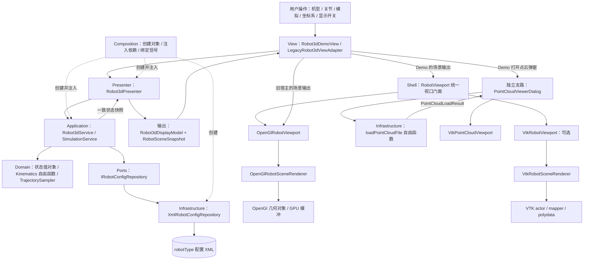

业务状态的统一来源是 `Robot3dService::state_`。显示选项和工具描述由 Presenter 的 `scene_` 保存。Presenter 在 `refresh()` 中将服务快照同时用于数值展示和场景提交。

鼠标旋转、平移、缩放在具体视口内更新 `CameraState`；坐标系与显示开关通过信号回到 Presenter。点云查看是独立支路，当前未进入机器人 Presenter/Service。

## 3. MVP 核心与装配类图（G1）

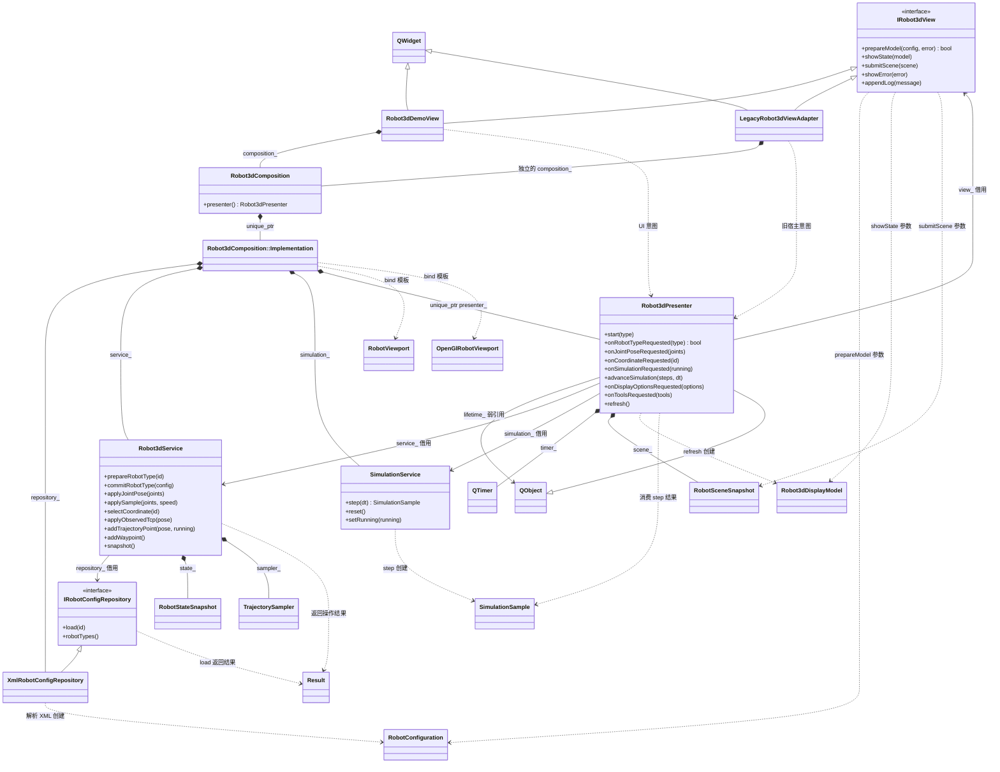

`Robot3dDemoView` 与旧适配器各自拥有独立装配，图中的共享类型节点不代表它们共享同一个实例。Composition 的内部成员销毁顺序使 Presenter/计时器先于服务释放。

代码依据：[Presenter 声明](../include/robot3d/presentation/Robot3dPresenter.h#L9)、[Service 声明](../include/robot3d/application/Robot3dService.h#L5)、[装配实现](../src/robot3d/composition/Robot3dComposition.cpp#L7)。

## 4. Model、展示模型与场景数据类图（G2）

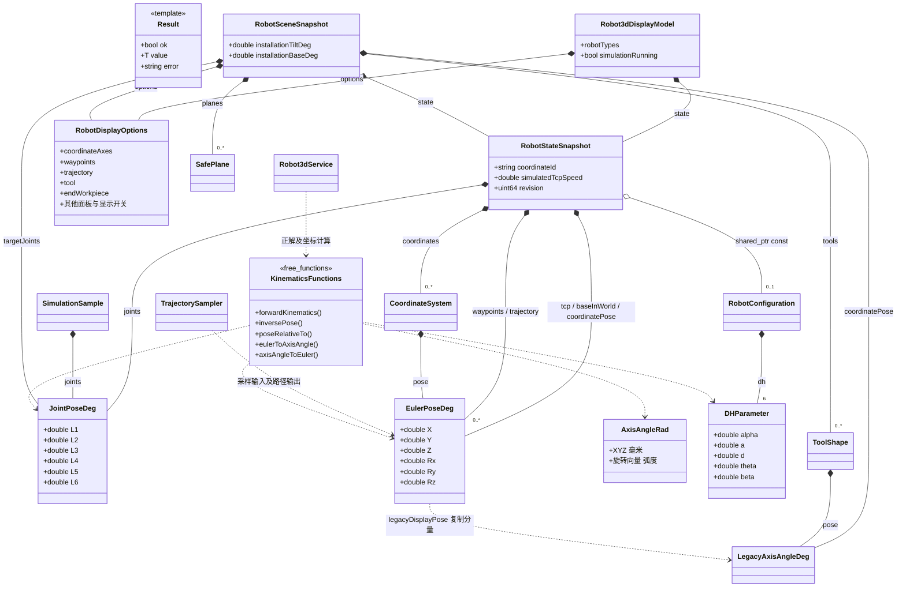

- `Result` 的实际定义是 `Result<T>`；图中的 `KinematicsFunctions` 是自由函数集合的说明节点，源码中没有这个类，也没有 `Kinematics` 类。
- `EulerPoseDeg` 的旋转语义是 ZYX 欧拉角；`AxisAngleRad` 是弧度旋转向量；`LegacyAxisAngleDeg` 隔离旧显示约定。`legacyDisplayPose()` 直接复制分量，不是欧拉角到轴角的数学转换。
- `RobotSceneSnapshot` 定义了安全平面、目标关节和安装角，但当前 Presenter 未提供这些字段的更新入口；不能据此推断已有完整 UI 业务链。
- `TrajectorySampler` 默认容量 1000，在至少一个 XYZ 方向与最后一点相差达到 5 mm 时采样；是否记录由 Service 的 `scriptRunning` 参数门控。

代码依据：[领域值对象](../include/robot3d/domain/RobotTypes.h#L9)、[场景契约](../include/robot3d/scene/RobotSceneSnapshot.h#L7)、[展示模型](../include/robot3d/presentation/Robot3dDisplayModel.h#L4)。

## 5. View、统一视口与后端关系（G3）

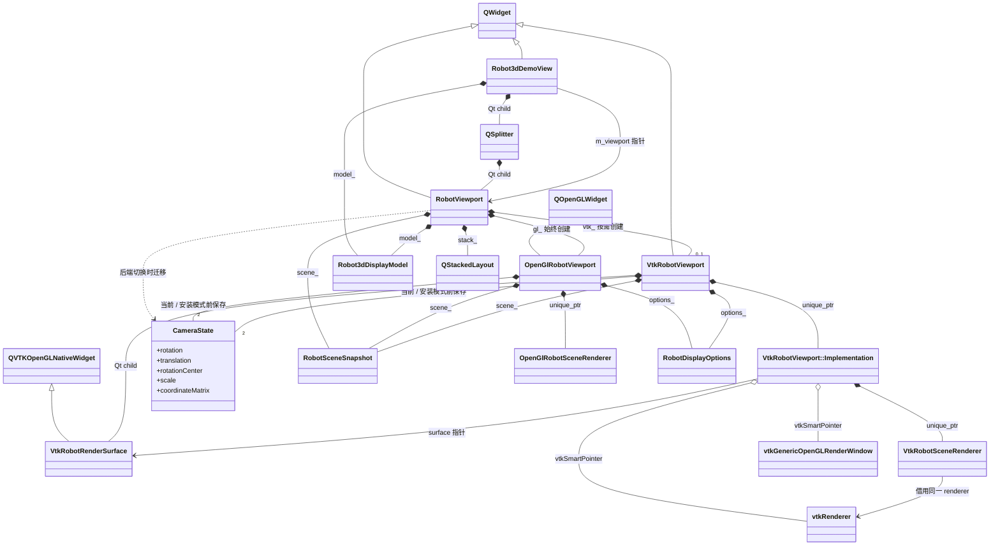

`RobotViewport` 是使用具体后端类型的门面。两个后端没有项目自定义的共同视口接口，也都不实现 `IRobot3dView`。VTK 相关窗口和渲染类仅在 `ROBOT3D_WITH_VTK=ON` 时编入。

`showState()` 同步两个已创建后端；普通 `prepareModel()`、`submitScene()`、`capture()` 面向活动后端。切换时，候选后端准备当前模型、取得当前场景及相机，并呈现相同 revision 后完成切换。

Composition 当前绑定的视口信号只有：`rendererReady → start`、`coordinateRequested → onCoordinateRequested`、`displayOptionsRequested → onDisplayOptionsRequested`。`poseConfirmed/poseCancelled` 虽经统一视口转发，主 Demo/Composition 尚未消费；`EndEditPose_signals` 没有经统一门面转发。

代码依据：[统一视口](../src/robot3d/shell/RobotViewport.cpp#L8)、[切换实现](../src/robot3d/shell/RobotViewport.cpp#L103)、[绑定信号](../src/robot3d/composition/Robot3dComposition.cpp#L15)。

## 6. OpenGL 渲染器、图元与数据（G4）

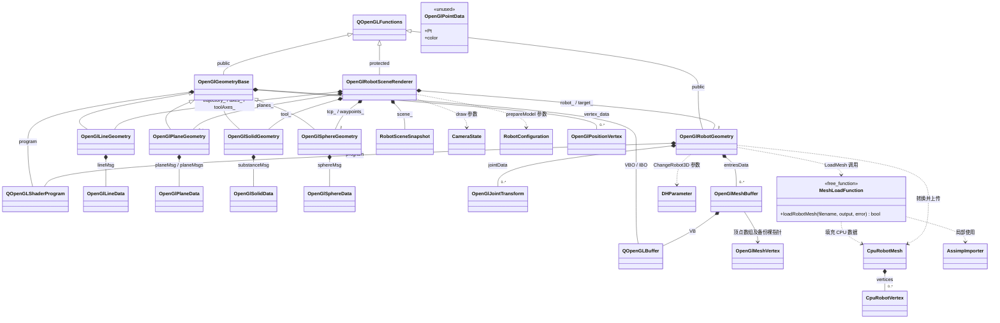

- `OpenGlRobotGeometry` 直接继承 `QOpenGLFunctions`，不继承 `OpenGlGeometryBase`。`OpenGlGeometryBase` 也不是抽象类：其 virtual 函数没有纯虚声明。
- `OpenGlMeshBuffer` 的顶点指针本身不具备 RAII 数组管理；分配、释放由 `OpenGlRobotGeometry::LoadMesh/clearMesh` 完成。
- `OpenGlPointData` 当前仅有定义，在生产代码中没有使用者。
- 图中的 `MeshLoadFunction` 是 `RobotMeshLoader.h/.cpp` 内 `loadRobotMesh()` 的说明节点；不存在 `RobotMeshLoader` 类。
- `OpenGl*Geometry`、`OpenGl*Data`、顶点、缓冲和关节变换类型位于全局命名空间；两个 SceneRenderer、CameraState、CpuRobot 类型位于 `robot3d::rendering`。

代码依据：[OpenGL Renderer](../include/robot3d/rendering/opengl/OpenGlRobotSceneRenderer.h#L14)、[机器人几何类](../include/robot3d/rendering/opengl/geometry/OpenGlRobotGeometry.h#L13)、[几何数据](../include/robot3d/rendering/opengl/geometry/OpenGlGeometryData.h#L8)。

## 7. VTK 场景渲染类图（G5）

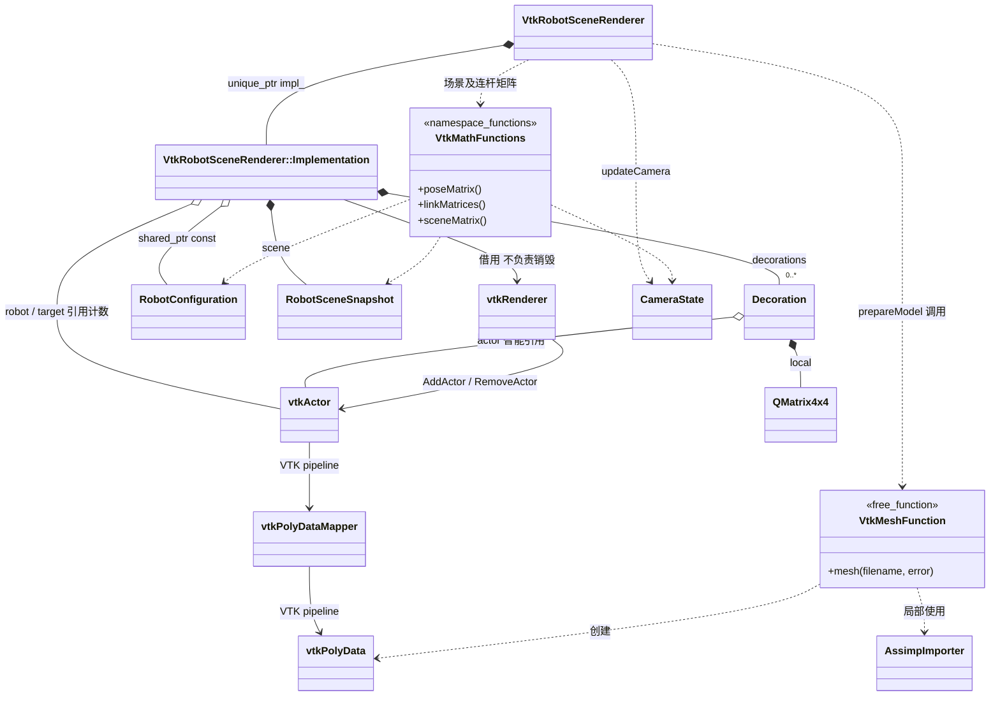

`VtkSceneMath.h` 是 `robot3d::rendering::vtkmath` 命名空间中的函数集合，不是类。VTK 后端在自身 `.cpp` 的 `mesh()` 中独立使用 Assimp 解析；当前没有调用 OpenGL 路径使用的 `loadRobotMesh()`。

`SceneUnits.h` 只定义常量 `kMillimetersToModelUnits = 0.04`，两个后端共享毫米到显示模型单位的换算约定。

代码依据：[VTK Renderer 内部实现](../src/robot3d/rendering/vtk/VtkRobotSceneRenderer.cpp#L105)、[VTK 数学函数](../include/robot3d/rendering/vtk/VtkSceneMath.h#L6)。

## 8. 点云支路及全部解析器内部类型（G6）

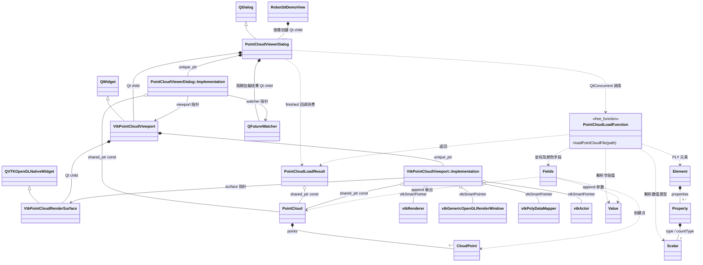

`Scalar`、`Value`、`Fields`、`Property`、`Element` 均位于 `PointCloudFileLoader.cpp` 的匿名命名空间；图中自由函数节点概括其内部格式分派链。`PointCloudFileLoader` 是文件名，源码中没有这个类。

加载结果在工作线程生成，由 `QFutureWatcher<PointCloudLoadResult>` 回到 UI 线程处理，再交给 VTK 视口。点大小、颜色、显隐和相机复位直接操作点云视口。

代码依据：[点云弹窗实现](../src/robot3d/shell/PointCloudViewerDialog.cpp#L24)、[点云视口内部实现](../src/robot3d/shell/vtk/VtkPointCloudViewport.cpp#L22)、[解析入口](../src/robot3d/infrastructure/PointCloudFileLoader.cpp#L293)。

## 9. 旧宿主适配、输入辅助与测试类型

### 9.1 兼容边界与输入辅助（G7）

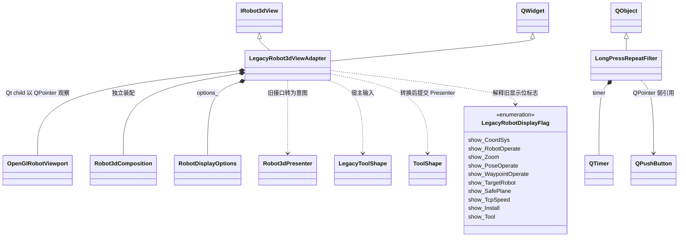

旧别名不另算类：`LegacyJointPose = domain::JointPoseDeg`、`LegacyEulerPose = domain::EulerPoseDeg`、`LegacyDhParameter = domain::DHParameter`。`LegacyRobotDisplayFlags` 是 `QFlags<LegacyRobotDisplayFlag>`；`RobotConfigurationPtr` 是 `shared_ptr<const RobotConfiguration>`。VTK 中的 `Actor/Poly` 也是智能指针别名。

适配器保留静态 `QPointer` 宿主门面入口，但每个适配实例内部仍持有自己的 MVP 组合。它直接使用 OpenGL 视口，不经过 `RobotViewport` 双后端门面。

`LongPressRepeatFilter` 当前只有自身实现和测试，生产 `include/src` 中没有使用者；不要把它画成视口的现有成员。两个视口的缩放按钮使用 `QPushButton::setAutoRepeat()`。

### 9.2 测试辅助类型（G8）

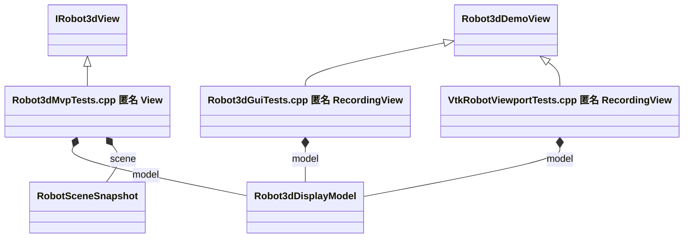

两个 `RecordingView` 位于不同测试翻译单元的匿名命名空间，是两个不同类型；没有合并成同一个类。`PointCloudFileLoaderTests.cpp` 没有定义额外测试类。

## 10. CMake 生产目标依赖与源码目录

以下箭头表示目标直接依赖（使用方 → 被使用方），不是运行时数据流；第三方依赖只在表中概括。

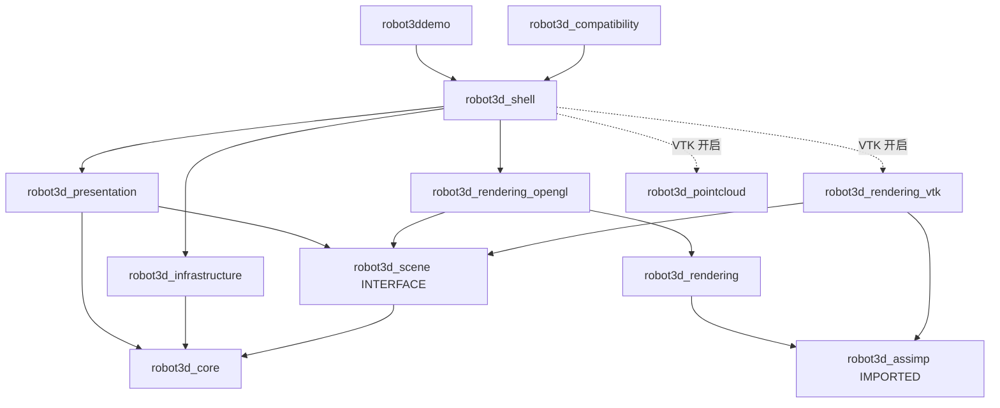

| 目录/目标 | 内容与职责 | 主要第三方依赖 |
| --- | --- | --- |
| `core/domain/application/ports` → `robot3d_core` | Result、业务状态、领域计算、服务与端口契约 | C++ 标准库；不依赖 Qt/VTK/Assimp |
| `scene` → `robot3d_scene` | 值类型场景和显示契约；INTERFACE 目标 | 无独立编译实现 |
| `presentation` → `robot3d_presentation` | Presenter、View 接口、展示模型 | Qt Core |
| `infrastructure/XmlRobotConfigRepository` → `robot3d_infrastructure` | 配置仓储实现 | Qt Core / Xml |
| `infrastructure/PointCloudFileLoader` → `robot3d_pointcloud` | 点云格式解析 | Qt Core |
| `rendering/RobotMeshLoader` → `robot3d_rendering` | CPU 网格加载 | Qt Gui / Assimp |
| `rendering/opengl` → `robot3d_rendering_opengl` | OpenGL 绘制和图元资源 | Qt Gui / OpenGL、opengl32 |
| `rendering/vtk` → `robot3d_rendering_vtk` | VTK 机器人绘制 | Qt Gui / VTK / Assimp |
| `shell` + `composition` → `robot3d_shell` | 具体 UI、视口、装配；可选点云窗口 | Qt Widgets；VTK 构建时另含 Qt Concurrent / VTK |
| `compatibility` → `robot3d_compatibility` | 旧宿主 View 适配器和旧输入值类型 | 经 shell 依赖 Qt |
| `main.cpp` + `demo.qrc` → `robot3ddemo` | QApplication、主窗口、资源 | 经 shell 取得依赖 |

说明：`robot3d_pointcloud` 直接链接 Qt Core，其点云领域值对象通过头文件使用，CMake 没有声明到 `robot3d_core` 的链接边。Composition 当前编入 shell，没有独立的 composition 库目标。

## 11. 两条关键业务时序

### 11.1 修改关节 / 模拟推进

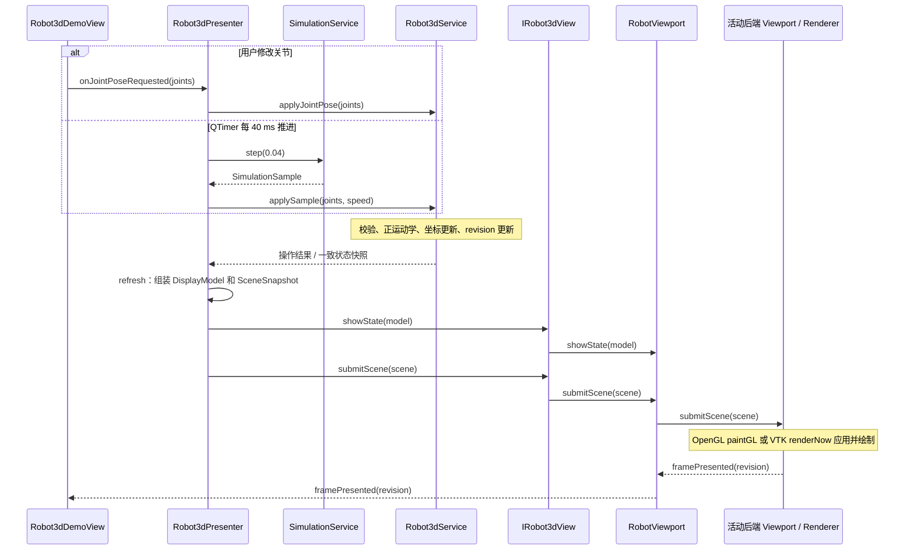

### 11.2 机型切换

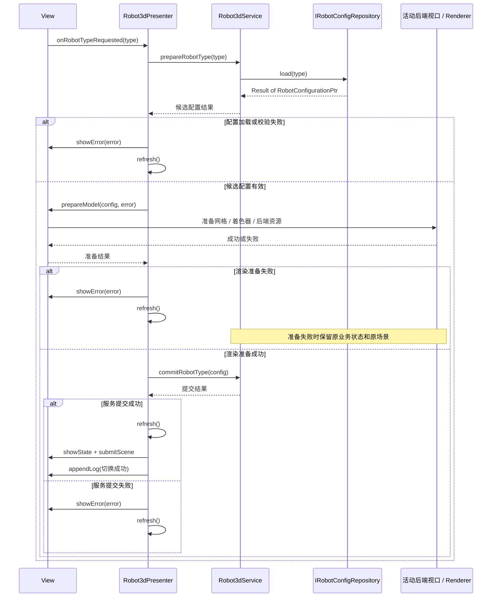

配置加载失败会直接报错并提前返回，不进入 `prepareModel()`；上图中的后端准备段仅在候选配置有效时发生。服务业务提交在渲染准备成功之后执行。

## 12. 完整类型索引

下表由源码中实际 `class/struct/enum` 定义生成；只取定义，不把前向声明、别名和函数集合算作类。图号对应上文 G1～G8；重复出现的类型只在索引中计数一次。

### 12.1 生产类和结构体：68 个

| 序号 | 类型 | 定义位置 | 图 |
| --- | --- | --- | --- |
| 1 | `class` `Robot3dService` | [include/robot3d/application/Robot3dService.h:5](../include/robot3d/application/Robot3dService.h#L5) | G1 |
| 2 | `struct` `SimulationSample` | [include/robot3d/application/SimulationService.h:4](../include/robot3d/application/SimulationService.h#L4) | G2 |
| 3 | `class` `SimulationService` | [include/robot3d/application/SimulationService.h:5](../include/robot3d/application/SimulationService.h#L5) | G1 |
| 4 | `class` `LegacyRobot3dViewAdapter` | [include/robot3d/compatibility/LegacyRobot3dViewAdapter.h:10](../include/robot3d/compatibility/LegacyRobot3dViewAdapter.h#L10) | G7 |
| 5 | `struct` `LegacyToolShape` | [include/robot3d/compatibility/LegacyRobotTypes.h:25](../include/robot3d/compatibility/LegacyRobotTypes.h#L25) | G7 |
| 6 | `class` `Robot3dComposition` | [include/robot3d/composition/Robot3dComposition.h:9](../include/robot3d/composition/Robot3dComposition.h#L9) | G1 |
| 7 | `struct` `Result<T>` | [include/robot3d/core/Result.h:4](../include/robot3d/core/Result.h#L4) | G2 |
| 8 | `struct` `CloudPoint` | [include/robot3d/domain/PointCloud.h:6](../include/robot3d/domain/PointCloud.h#L6) | G6 |
| 9 | `struct` `PointCloud` | [include/robot3d/domain/PointCloud.h:10](../include/robot3d/domain/PointCloud.h#L10) | G6 |
| 10 | `struct` `JointPoseDeg` | [include/robot3d/domain/RobotTypes.h:9](../include/robot3d/domain/RobotTypes.h#L9) | G2 |
| 11 | `struct` `EulerPoseDeg` | [include/robot3d/domain/RobotTypes.h:10](../include/robot3d/domain/RobotTypes.h#L10) | G2 |
| 12 | `struct` `AxisAngleRad` | [include/robot3d/domain/RobotTypes.h:11](../include/robot3d/domain/RobotTypes.h#L11) | G2 |
| 13 | `struct` `DHParameter` | [include/robot3d/domain/RobotTypes.h:12](../include/robot3d/domain/RobotTypes.h#L12) | G2 |
| 14 | `struct` `CoordinateSystem` | [include/robot3d/domain/RobotTypes.h:13](../include/robot3d/domain/RobotTypes.h#L13) | G2 |
| 15 | `struct` `RobotConfiguration` | [include/robot3d/domain/RobotTypes.h:14](../include/robot3d/domain/RobotTypes.h#L14) | G2 |
| 16 | `struct` `RobotStateSnapshot` | [include/robot3d/domain/RobotTypes.h:21](../include/robot3d/domain/RobotTypes.h#L21) | G2 |
| 17 | `class` `TrajectorySampler` | [include/robot3d/domain/TrajectorySampler.h:5](../include/robot3d/domain/TrajectorySampler.h#L5) | G2 |
| 18 | `struct` `PointCloudLoadResult` | [include/robot3d/infrastructure/PointCloudFileLoader.h:6](../include/robot3d/infrastructure/PointCloudFileLoader.h#L6) | G6 |
| 19 | `class` `XmlRobotConfigRepository` | [include/robot3d/infrastructure/XmlRobotConfigRepository.h:4](../include/robot3d/infrastructure/XmlRobotConfigRepository.h#L4) | G1 |
| 20 | `class` `IRobotConfigRepository` | [include/robot3d/ports/IRobotConfigRepository.h:5](../include/robot3d/ports/IRobotConfigRepository.h#L5) | G1 |
| 21 | `class` `IRobot3dView` | [include/robot3d/presentation/IRobot3dView.h:4](../include/robot3d/presentation/IRobot3dView.h#L4) | G1 |
| 22 | `struct` `Robot3dDisplayModel` | [include/robot3d/presentation/Robot3dDisplayModel.h:4](../include/robot3d/presentation/Robot3dDisplayModel.h#L4) | G2 |
| 23 | `class` `Robot3dPresenter` | [include/robot3d/presentation/Robot3dPresenter.h:9](../include/robot3d/presentation/Robot3dPresenter.h#L9) | G1 |
| 24 | `struct` `CameraState` | [include/robot3d/rendering/CameraState.h:6](../include/robot3d/rendering/CameraState.h#L6) | G3 |
| 25 | `struct` `CpuRobotVertex` | [include/robot3d/rendering/RobotMeshLoader.h:6](../include/robot3d/rendering/RobotMeshLoader.h#L6) | G4 |
| 26 | `struct` `CpuRobotMesh` | [include/robot3d/rendering/RobotMeshLoader.h:7](../include/robot3d/rendering/RobotMeshLoader.h#L7) | G4 |
| 27 | `class` `OpenGlRobotSceneRenderer` | [include/robot3d/rendering/opengl/OpenGlRobotSceneRenderer.h:14](../include/robot3d/rendering/opengl/OpenGlRobotSceneRenderer.h#L14) | G4 |
| 28 | `class` `OpenGlGeometryBase` | [include/robot3d/rendering/opengl/geometry/OpenGlGeometryBase.h:19](../include/robot3d/rendering/opengl/geometry/OpenGlGeometryBase.h#L19) | G4 |
| 29 | `struct` `OpenGlPositionVertex` | [include/robot3d/rendering/opengl/geometry/OpenGlGeometryData.h:8](../include/robot3d/rendering/opengl/geometry/OpenGlGeometryData.h#L8) | G4 |
| 30 | `struct` `OpenGlSolidData` | [include/robot3d/rendering/opengl/geometry/OpenGlGeometryData.h:13](../include/robot3d/rendering/opengl/geometry/OpenGlGeometryData.h#L13) | G4 |
| 31 | `struct` `OpenGlSphereData` | [include/robot3d/rendering/opengl/geometry/OpenGlGeometryData.h:24](../include/robot3d/rendering/opengl/geometry/OpenGlGeometryData.h#L24) | G4 |
| 32 | `struct` `OpenGlLineData` | [include/robot3d/rendering/opengl/geometry/OpenGlGeometryData.h:31](../include/robot3d/rendering/opengl/geometry/OpenGlGeometryData.h#L31) | G4 |
| 33 | `struct` `OpenGlPointData` | [include/robot3d/rendering/opengl/geometry/OpenGlGeometryData.h:38](../include/robot3d/rendering/opengl/geometry/OpenGlGeometryData.h#L38) | G4 |
| 34 | `struct` `OpenGlPlaneData` | [include/robot3d/rendering/opengl/geometry/OpenGlGeometryData.h:44](../include/robot3d/rendering/opengl/geometry/OpenGlGeometryData.h#L44) | G4 |
| 35 | `struct` `OpenGlMeshVertex` | [include/robot3d/rendering/opengl/geometry/OpenGlGeometryData.h:54](../include/robot3d/rendering/opengl/geometry/OpenGlGeometryData.h#L54) | G4 |
| 36 | `struct` `OpenGlJointTransform` | [include/robot3d/rendering/opengl/geometry/OpenGlGeometryData.h:61](../include/robot3d/rendering/opengl/geometry/OpenGlGeometryData.h#L61) | G4 |
| 37 | `struct` `OpenGlMeshBuffer` | [include/robot3d/rendering/opengl/geometry/OpenGlGeometryData.h:68](../include/robot3d/rendering/opengl/geometry/OpenGlGeometryData.h#L68) | G4 |
| 38 | `class` `OpenGlLineGeometry` | [include/robot3d/rendering/opengl/geometry/OpenGlLineGeometry.h:6](../include/robot3d/rendering/opengl/geometry/OpenGlLineGeometry.h#L6) | G4 |
| 39 | `class` `OpenGlPlaneGeometry` | [include/robot3d/rendering/opengl/geometry/OpenGlPlaneGeometry.h:5](../include/robot3d/rendering/opengl/geometry/OpenGlPlaneGeometry.h#L5) | G4 |
| 40 | `class` `OpenGlRobotGeometry` | [include/robot3d/rendering/opengl/geometry/OpenGlRobotGeometry.h:13](../include/robot3d/rendering/opengl/geometry/OpenGlRobotGeometry.h#L13) | G4 |
| 41 | `class` `OpenGlSolidGeometry` | [include/robot3d/rendering/opengl/geometry/OpenGlSolidGeometry.h:6](../include/robot3d/rendering/opengl/geometry/OpenGlSolidGeometry.h#L6) | G4 |
| 42 | `class` `OpenGlSphereGeometry` | [include/robot3d/rendering/opengl/geometry/OpenGlSphereGeometry.h:6](../include/robot3d/rendering/opengl/geometry/OpenGlSphereGeometry.h#L6) | G4 |
| 43 | `class` `VtkRobotSceneRenderer` | [include/robot3d/rendering/vtk/VtkRobotSceneRenderer.h:9](../include/robot3d/rendering/vtk/VtkRobotSceneRenderer.h#L9) | G5 |
| 44 | `struct` `RobotDisplayOptions` | [include/robot3d/scene/RobotDisplayOptions.h:3](../include/robot3d/scene/RobotDisplayOptions.h#L3) | G2 |
| 45 | `struct` `LegacyAxisAngleDeg` | [include/robot3d/scene/RobotSceneSnapshot.h:7](../include/robot3d/scene/RobotSceneSnapshot.h#L7) | G2 |
| 46 | `struct` `ToolShape` | [include/robot3d/scene/RobotSceneSnapshot.h:9](../include/robot3d/scene/RobotSceneSnapshot.h#L9) | G2 |
| 47 | `struct` `SafePlane` | [include/robot3d/scene/RobotSceneSnapshot.h:10](../include/robot3d/scene/RobotSceneSnapshot.h#L10) | G2 |
| 48 | `struct` `RobotSceneSnapshot` | [include/robot3d/scene/RobotSceneSnapshot.h:11](../include/robot3d/scene/RobotSceneSnapshot.h#L11) | G2 |
| 49 | `class` `PointCloudViewerDialog` | [include/robot3d/shell/PointCloudViewerDialog.h:4](../include/robot3d/shell/PointCloudViewerDialog.h#L4) | G6 |
| 50 | `class` `Robot3dDemoView` | [include/robot3d/shell/Robot3dDemoView.h:15](../include/robot3d/shell/Robot3dDemoView.h#L15) | G3 |
| 51 | `class` `RobotViewport` | [include/robot3d/shell/RobotViewport.h:8](../include/robot3d/shell/RobotViewport.h#L8) | G3 |
| 52 | `class` `LongPressRepeatFilter` | [include/robot3d/shell/input/LongPressRepeatFilter.h:7](../include/robot3d/shell/input/LongPressRepeatFilter.h#L7) | G7 |
| 53 | `class` `OpenGlRobotViewport` | [include/robot3d/shell/opengl/OpenGlRobotViewport.h:16](../include/robot3d/shell/opengl/OpenGlRobotViewport.h#L16) | G3 |
| 54 | `class` `VtkPointCloudViewport` | [include/robot3d/shell/vtk/VtkPointCloudViewport.h:7](../include/robot3d/shell/vtk/VtkPointCloudViewport.h#L7) | G6 |
| 55 | `class` `VtkRobotViewport` | [include/robot3d/shell/vtk/VtkRobotViewport.h:10](../include/robot3d/shell/vtk/VtkRobotViewport.h#L10) | G3 |
| 56 | `struct` `Robot3dComposition::Implementation` | [src/robot3d/composition/Robot3dComposition.cpp:7](../src/robot3d/composition/Robot3dComposition.cpp#L7) | G1 |
| 57 | `struct` `Scalar（匿名命名空间）` | [src/robot3d/infrastructure/PointCloudFileLoader.cpp:38](../src/robot3d/infrastructure/PointCloudFileLoader.cpp#L38) | G6 |
| 58 | `struct` `Value（匿名命名空间）` | [src/robot3d/infrastructure/PointCloudFileLoader.cpp:54](../src/robot3d/infrastructure/PointCloudFileLoader.cpp#L54) | G6 |
| 59 | `struct` `Fields（匿名命名空间）` | [src/robot3d/infrastructure/PointCloudFileLoader.cpp:102](../src/robot3d/infrastructure/PointCloudFileLoader.cpp#L102) | G6 |
| 60 | `struct` `Property（匿名命名空间）` | [src/robot3d/infrastructure/PointCloudFileLoader.cpp:228](../src/robot3d/infrastructure/PointCloudFileLoader.cpp#L228) | G6 |
| 61 | `struct` `Element（匿名命名空间）` | [src/robot3d/infrastructure/PointCloudFileLoader.cpp:229](../src/robot3d/infrastructure/PointCloudFileLoader.cpp#L229) | G6 |
| 62 | `struct` `Decoration（匿名命名空间）` | [src/robot3d/rendering/vtk/VtkRobotSceneRenderer.cpp:105](../src/robot3d/rendering/vtk/VtkRobotSceneRenderer.cpp#L105) | G5 |
| 63 | `struct` `VtkRobotSceneRenderer::Implementation` | [src/robot3d/rendering/vtk/VtkRobotSceneRenderer.cpp:108](../src/robot3d/rendering/vtk/VtkRobotSceneRenderer.cpp#L108) | G5 |
| 64 | `struct` `PointCloudViewerDialog::Implementation` | [src/robot3d/shell/PointCloudViewerDialog.cpp:24](../src/robot3d/shell/PointCloudViewerDialog.cpp#L24) | G6 |
| 65 | `class` `VtkPointCloudRenderSurface` | [src/robot3d/shell/vtk/VtkPointCloudViewport.cpp:22](../src/robot3d/shell/vtk/VtkPointCloudViewport.cpp#L22) | G6 |
| 66 | `struct` `VtkPointCloudViewport::Implementation` | [src/robot3d/shell/vtk/VtkPointCloudViewport.cpp:36](../src/robot3d/shell/vtk/VtkPointCloudViewport.cpp#L36) | G6 |
| 67 | `class` `VtkRobotRenderSurface` | [src/robot3d/shell/vtk/VtkRobotViewport.cpp:28](../src/robot3d/shell/vtk/VtkRobotViewport.cpp#L28) | G3 |
| 68 | `struct` `VtkRobotViewport::Implementation` | [src/robot3d/shell/vtk/VtkRobotViewport.cpp:46](../src/robot3d/shell/vtk/VtkRobotViewport.cpp#L46) | G3 |

### 12.2 枚举与测试辅助类型

| 类型 | 定义位置 | 图 |
| --- | --- | --- |
| `enum` `LegacyRobotDisplayFlag` | [include/robot3d/compatibility/LegacyRobotTypes.h:20](../include/robot3d/compatibility/LegacyRobotTypes.h#L20) | G7 |
| `class` `RecordingView` | [tests/Robot3dGuiTests.cpp:26](../tests/Robot3dGuiTests.cpp#L26) | G8 |
| `struct` `View` | [tests/Robot3dMvpTests.cpp:18](../tests/Robot3dMvpTests.cpp#L18) | G8 |
| `class` `RecordingView` | [tests/VtkRobotViewportTests.cpp:41](../tests/VtkRobotViewportTests.cpp#L41) | G8 |

## 13. 当前实现边界

1. Presenter 不依赖具体 View 或 Renderer 头文件；核心领域/应用目标不依赖 Qt、VTK、OpenGL 或 Assimp。
2. 渲染器消费同一场景契约，但并未实现一个统一的 `ISceneRenderer` 接口；统一后端切换发生在 `RobotViewport` 门面。
3. 当前没有 `SceneBuilder` 类，场景与展示模型在 Presenter 的 `refresh()` 内组装；也没有 `Kinematics`、`RobotMeshLoader`、`PointCloudFileLoader`、`VtkSceneMath`、`SceneUnits` 这些同名类。
4. 点云支路独立于机器人 MVP；`LongPressRepeatFilter` 与 `OpenGlPointData` 虽有定义，当前未接入生产调用链。
5. 本文反映当前源码结构。历史文档中的 DemoUi、Robot3dGLWidget、RobotSceneRenderer、BaseGeometry、Robot3dControlWidget 等旧名不作为现有类计入。

本文仅新增架构说明文档，未修改程序源码；未重新构建或运行功能测试。已核对类/结构体数量、类型覆盖、定义位置和文档链接。
